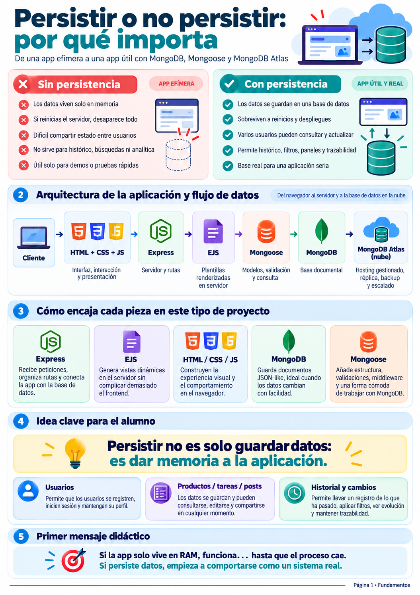
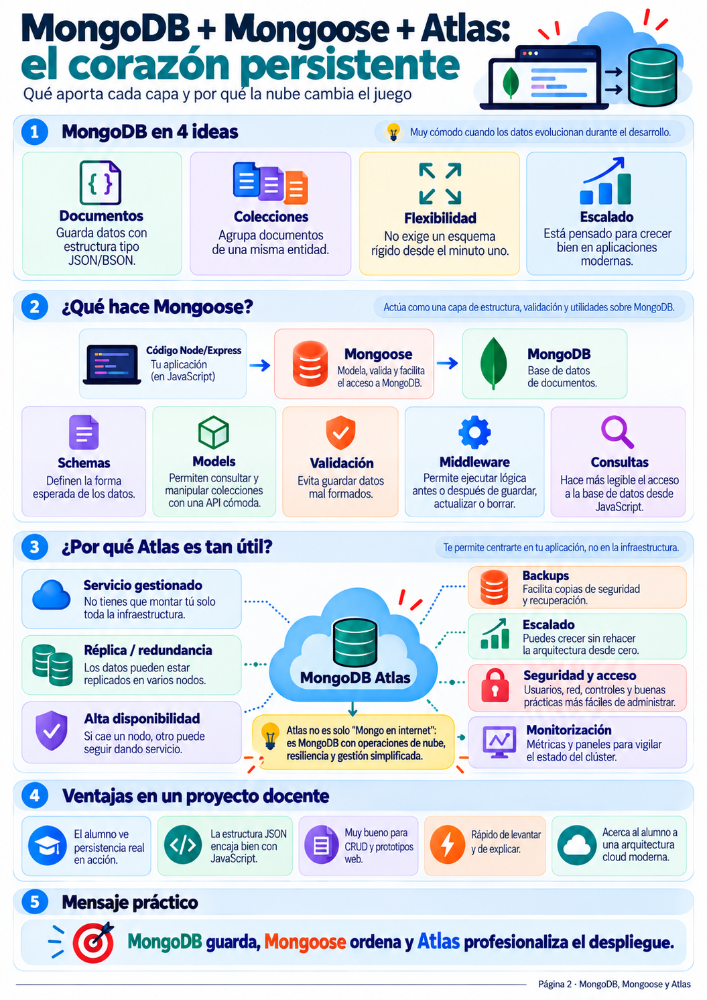
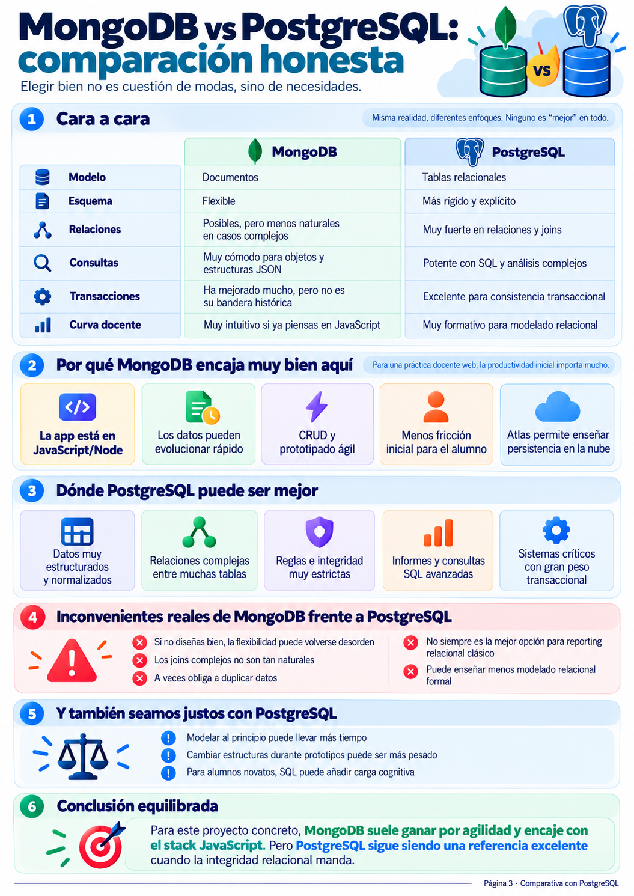
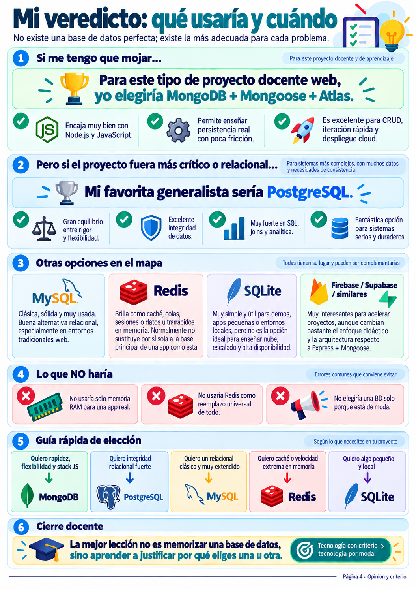

# Módulo 1: Fundamentos de Persistencia y Criterio de Selección de Bases de Datos
> **De una aplicación efímera en memoria a un sistema resiliente con MongoDB, Mongoose y MongoDB Atlas.**  
> *Basado en la serie infográfica «Persistir vs No Persistir» (Páginas 1 a 4).*

---

📍 **Navegación:** [🏠 Volver al README Principal](./README.md) | [Siguiente: Módulo 2 (Curso Práctico awcodeAtlas.js) ➡️](./02-curso-practica-awcodeAtlas-crud-completo.md)

---



---

## 1. El Dilema Fundamental: ¿Persistir o No Persistir?

Cuando nos iniciamos en el desarrollo web con Node.js y Express, es habitual comenzar almacenando la información en estructuras de datos volátiles: un array en memoria de JavaScript (`let items = ["Comprar leche", "Estudiar Node"];`).

Aunque este enfoque parece suficiente en los primeros minutos de clase o en una prueba de concepto rápida, presenta limitaciones que impiden que el software se comporte como una aplicación real:

```
┌─────────────────────────────────┐           ┌─────────────────────────────────┐
│       APP SIN PERSISTENCIA      │           │       APP CON PERSISTENCIA      │
│          (Memoria RAM)          │           │       (Base de Datos Cloud)     │
├─────────────────────────────────┤           ├─────────────────────────────────┤
│ ❌ Datos en memoria volátil     │           │ ✔️ Datos almacenados en disco   │
│ ❌ Un reinicio lo borra todo    │           │ ✔️ Sobrevive a caídas y deploys │
│ ❌ Imposible compartir estado   │           │ ✔️ Varios clientes sincronizados│
│ ❌ Sin histórico ni analítica   │           │ ✔️ Auditoría, filtros y queries │
│ ❌ Solo apto para demos simples │           │ ✔️ Lista para producción real   │
└─────────────────────────────────┘           └─────────────────────────────────┘
```

### El ciclo de vida de los datos en memoria vs persistencia
1. **App Efímera (Solo RAM):** El servidor Express mantiene los datos mientras el proceso de Node.js permanezca en ejecución. En el momento en que el proceso muere —ya sea por un error no capturado, un reinicio del sistema o un nuevo despliegue en la nube— la memoria asignada se libera y todos los datos desaparecen para siempre.
2. **App Persistente (Base de Datos):** La lógica de negocio delega la custodia de los datos a un motor especializado (en nuestro caso, MongoDB Atlas). El servidor Node.js se convierte en un intermediario sin estado (*stateless*), lo que permite destruir, reiniciar o escalar instancias de la aplicación sin perder un solo registro.

> [!IMPORTANT]
> **Mensaje didáctico clave:**  
> *Persistir no es simplemente «guardar datos»: es otorgarle memoria y ciclo de vida duradero a la aplicación.*  
> Si la app solo vive en RAM, funciona únicamente hasta que el proceso cae. Al dotarla de persistencia, se transforma en un sistema de software real.

---

## 2. Arquitectura de la Aplicación y Flujo de Datos

Para que una petición de usuario se convierta en un registro persistente y vuelva renderizada a su pantalla, intervienen seis piezas coordinadas:

```
[ Cliente ] ──▶ [ HTML/CSS/JS ] ──▶ [ Express ] ──▶ [ EJS ] ──▶ [ Mongoose ] ──▶ [ MongoDB ] ──▶ [ MongoDB Atlas ]
 Navegador         Frontend          Servidor        Plantillas     ODM /         Base de Datos      Hosting Cloud
  Usuario          Estático          y Rutas         Dinámicas     Modelado       Documental          Gestionado
```

### ¿Cómo encaja cada pieza del stack?

1. **Cliente (Navegador):** Emite peticiones HTTP (GET para consultar listas, POST para añadir o eliminar tareas) y renderiza la respuesta final.
2. **HTML5 + CSS3 + JS del Navegador:** Define la estructura visual de la interfaz, los estilos responsivos (`public/css/styles.css`) y posibles microinteracciones en el cliente.
3. **Servidor Express (Node.js):** Actúa como el cerebro receptor. Enruta las peticiones entrantes (`/`, `/:customListName`, `/delete`), ejecuta los middlewares y coordina la lógica de negocio.
4. **Motor de Vistas EJS (*Embedded JavaScript*):** Genera HTML dinámico directamente en el servidor. Inyecta los documentos devueltos por la base de datos dentro de las plantillas (`views/list.ejs`), simplificando el frontend sin obligar al alumno a lidiar con complejas arquitecturas SPA en fases tempranas.
5. **Mongoose (ODM - *Object Data Modeling*):** Capa de abstracción que traduce objetos JavaScript a documentos BSON de MongoDB. Aplica esquemas, validaciones estrictas y métodos de consulta legibles.
6. **MongoDB:** Motor de base de datos NoSQL documental de alto rendimiento, optimizado para almacenar documentos flexibles tipo JSON.
7. **MongoDB Atlas:** El servicio en la nube que gestiona la base de datos con alta disponibilidad, redundancia distribuida mediante Replica Sets, copias de seguridad automáticas y cifrado TLS.

---



---

## 3. MongoDB, Mongoose y Atlas: El Corazón Persistente

Comprender la diferencia de responsabilidades entre MongoDB, Mongoose y MongoDB Atlas evita errores comunes de conceptualización:

### A. MongoDB en 4 ideas esenciales
* **Documentos:** La unidad de almacenamiento es un documento BSON (*Binary JSON*). En lugar de filas y columnas rígidas, los datos se leen y escriben con la naturalidad de un objeto literal de JavaScript: `{ _id: ObjectId("..."), name: "Comprar pan" }`.
* **Colecciones:** Conjunto de documentos análogos (el equivalente conceptual a una tabla en bases de datos relacionales).
* **Flexibilidad estructural:** No exige definir todas las columnas de antemano; los esquemas pueden evolucionar a medida que crecen los requisitos de la aplicación.
* **Escalabilidad horizontal nativa:** Diseñado desde su concepción para crecer mediante *sharding* y particionamiento sin romper la lógica del software.

### B. ¿Qué papel cumple Mongoose?
Mongoose se sitúa entre Express y MongoDB para aportar el orden y rigor necesarios en proyectos profesionales:

```
[ Código Node/Express ] ──▶ [ Mongoose (ODM) ] ──▶ [ MongoDB ]
  Lógica en JavaScript         Esquemas, Validaciones,   Base de Datos
                               Modelos y Middlewares
```

* **Schemas (Esquemas):** Definen la estructura esperada de los datos, tipos de campo, valores por defecto y restricciones:
  ```javascript
  const itemsSchema = new mongoose.Schema({
    name: { type: String, required: true }
  });
  ```
* **Models (Modelos):** Constructores compilados a partir de los esquemas que exponen la API de consultas (`Item.find()`, `Item.findByIdAndDelete()`, `item.save()`).
* **Validación en Servidor:** Impide guardar registros mal formados o incompletos antes de que la petición toque la base de datos.
* **Middlewares / Hooks:** Permite ejecutar funciones antes (*pre*) o después (*post*) de guardar, actualizar o borrar documentos.

### C. ¿Por qué MongoDB Atlas cambia las reglas del juego?
En lugar de forzar al alumno o desarrollador a instalar, configurar y mantener un demonio local `mongod` —lo que a menudo deriva en fallos de permisos, puertos bloqueados o incompatibilidades entre sistemas operativos—, **MongoDB Atlas** ofrece un clúster gestionado en la nube con:
* **Réplica y Redundancia (Replica Sets):** Los datos se replican en múltiples nodos (un nodo primario de lectura/escritura y nodos secundarios de respaldo).
* **Alta Disponibilidad (*Failover* automático):** Si el nodo primario cae o sufre una interrupción, uno de los nodos secundarios asume el rol de primario de forma transparente.
* **Copias de seguridad automatizadas:** Puntos de restauración continuos frente a corrupciones o borrados accidentales.
* **Seguridad integral:** Cifrado en tránsito (TLS/SSL) y en reposo, autenticación basada en roles (*SCRAM*) y listas blancas de direcciones IP (*Network Access*).

> [!TIP]
> **Resumen didáctico de la tríada:**  
> *MongoDB guarda, Mongoose ordena y Atlas profesionaliza el despliegue.*

---



---

## 4. Comparativa Honesta: MongoDB (NoSQL) vs PostgreSQL (SQL)

La elección del motor de base de datos no debe obedecer a modas tecnológicas, sino a las necesidades intrínsecas del dominio de negocio.

### Matriz Comparativa Cara a Cara

| Criterio | MongoDB (NoSQL Documental) | PostgreSQL (SQL Objeto-Relacional) |
| :--- | :--- | :--- |
| **Modelo de Datos** | Documentos jerárquicos (BSON/JSON) | Tablas bidimensionales normalizadas (Filas/Columnas) |
| **Esquema** | Flexible, dinámico y evolutivo | Rígido, fuertemente tipado y explícito |
| **Relaciones entre Entidades**| Soportadas mediante referencias manuales o documentos embebidos; menos directas en modelos muy cruzados | Extraordinariamente potentes mediante claves foráneas y uniones (`JOIN`) complejas |
| **Consultas** | Orientadas a objetos, BSON y lenguaje de agregaciones (*Aggregation Pipeline*) | SQL estándar declarativo, filtros avanzados, subconsultas y análisis analítico complejo |
| **Transacciones (ACID)** | Soportadas en réplicas y clústeres desde v4.0, pero no es su premisa arquitectónica fundacional | Pilar central del motor; integridad transaccional estricta e incontestable |
| **Curva Docente con JS** | Muy intuitiva; el alumno piensa en objetos y arrays nativos de JavaScript | Exige aprender modelado relacional riguroso, normalización (1FN, 2FN, 3FN) y sintaxis SQL |

### ¿Por qué MongoDB encaja de forma ideal en este proyecto docente?
1. **Homogeneidad de lenguaje:** La aplicación está escrita en JavaScript. Tratar un documento de MongoDB como un objeto literal reduce drásticamente la fricción mental del estudiante.
2. **Prototipado ágil:** Modificar una tarea para que admita nuevos atributos (por ejemplo, una fecha de vencimiento o prioridad) no requiere ejecutar migraciones complejas de base de datos (`ALTER TABLE`).
3. **Estructura jerárquica natural:** Una lista de tareas que contiene dentro de sí un array de sub-tareas se modela de forma directa con un documento embebido en MongoDB:
   ```json
   {
     "_id": "64f1a2...",
     "name": "Trabajo",
     "items": [
       { "_id": "64f1a3...", "name": "Entregar informe mensual" },
       { "_id": "64f1a4...", "name": "Preparar presentación" }
     ]
   }
   ```
4. **Acceso directo a la nube:** MongoDB Atlas permite enseñar despliegue, réplicas y cadenas de conexión seguras sin obligar a configurar servidores de bases de datos locales.

### ¿Dónde y cuándo es superior PostgreSQL?
* Sistemas financieros, bancarios o de facturación donde la integridad referencial y las transacciones ACID estrictas sean innegociables.
* Modelos relacionales complejos donde una entidad se relaciona intensamente con decenas de otras entidades mediante tablas intermedias (Muchos a Muchos).
* Proyectos donde el análisis de datos masivo (*reporting*, BI) requiera un motor SQL maduro y optimizado.

---



---

## 5. El Veredicto de Arquitectura: Qué Base de Datos Elegir y Cuándo

No existe la «mejor» base de datos absoluta; existe la herramienta adecuada para cada problema de ingeniería de software.

```
                                  ¿QUÉ NECESITAS EN TU PROYECTO?
                                                │
         ┌──────────────────┬───────────────────┼───────────────────┬──────────────────┐
         ▼                  ▼                   ▼                   ▼                  ▼
    ¿Stack JS y        ¿Integridad         ¿Relacional         ¿Caché ultrarrápida    ¿App local,
    flexibilidad?      relacional pura?    clásico y web?      y colas en RAM?        demo o test?
         │                  │                   │                   │                  │
   [ MongoDB ]       [ PostgreSQL ]          [ MySQL ]           [ Redis ]         [ SQLite ]
```

### Panorama del Ecosistema de Almacenamiento

1. **MongoDB:**  
   *Uso recomendado:* Aplicaciones web y móviles basadas en Node.js, catálogos con propiedades dinámicas, sistemas de gestión de contenido (CMS), registros y tableros donde la rapidez de iteración sea prioritaria.
2. **PostgreSQL:**  
   *Uso recomendado:* Sistemas de gestión empresarial (ERP, CRM), plataformas de comercio electrónico complejas, finanzas, analítica relacional y cualquier escenario donde la consistencia de los datos esté por encima de la velocidad de desarrollo inicial.
3. **MySQL / MariaDB:**  
   *Uso recomendado:* La opción clásica y probada de la web tradicional (entornos LAMP/LEMP, WordPress, aplicaciones SaaS estándares).
4. **Redis:**  
   *Uso recomendado:* Base de datos clave-valor en memoria. No está pensada para sustituir a la base de datos principal, sino para complementarla como capa de caché de alto rendimiento, gestión de sesiones de usuario o colas de mensajería (*Pub/Sub*).
5. **SQLite:**  
   *Uso recomendado:* Base de datos relacional autocontenida en un único archivo de disco. Excelente para pruebas unitarias, aplicaciones de escritorio, apps móviles embebidas o prototipos locales ligeros; insuficiente para arquitecturas distribuidas con múltiples réplicas concurrentes en la nube.
6. **BaaS (Firebase / Supabase):**  
   *Uso recomendado:* Aplicaciones donde se requiera sincronización en tiempo real (*realtime*) directa al cliente o cuando se desee delegar por completo el backend en una plataforma integrada.

### Antipatrones que debemos evitar a toda costa
* ❌ **No utilizar la memoria RAM como sustituto de una base de datos** en ninguna aplicación que deba pasar de un entorno de pruebas a producción.
* ❌ **No usar Redis como almacén generalista persistente primario** para entidades con estructuras complejas.
* ❌ **No elegir una base de datos simplemente «porque está de moda»** o porque aparece en tutoriales populares, sino tras un análisis justificado de los requisitos de modelado, escalabilidad e integridad.

---

> [!NOTE]
> **Cierre pedagógico del Módulo:**  
> La mayor lección de este primer bloque no es memorizar la sintaxis de un método, sino desarrollar **criterio de arquitectura**: saber justificar con argumentos técnicos precisos por qué una solución tecnológica resuelve mejor un problema determinado que sus alternativas.

---

📍 **Navegación:** [🏠 Volver al README Principal](./README.md) | [Siguiente: Módulo 2 (Curso Práctico awcodeAtlas.js) ➡️](./02-curso-practica-awcodeAtlas-crud-completo.md)
