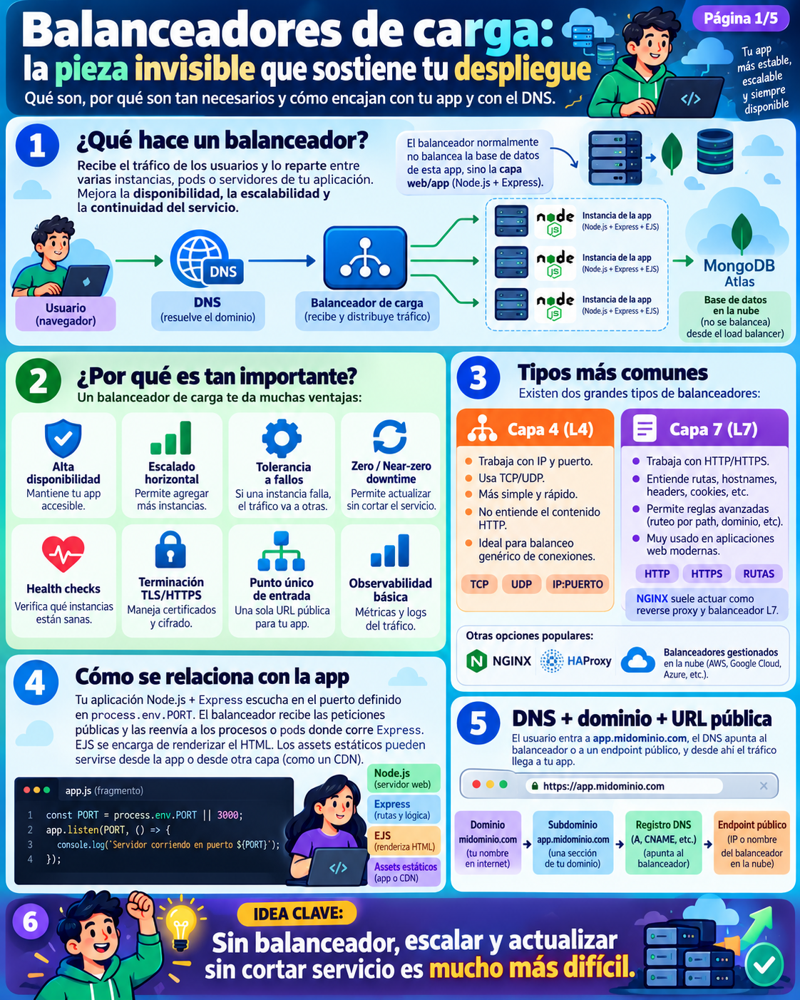
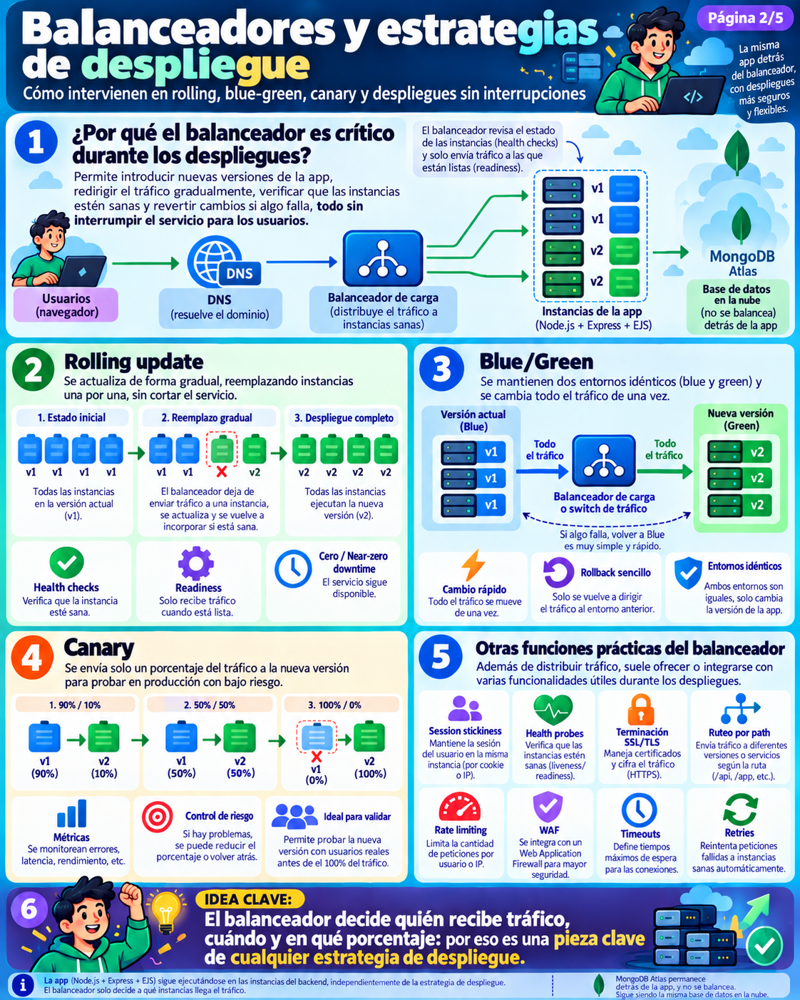
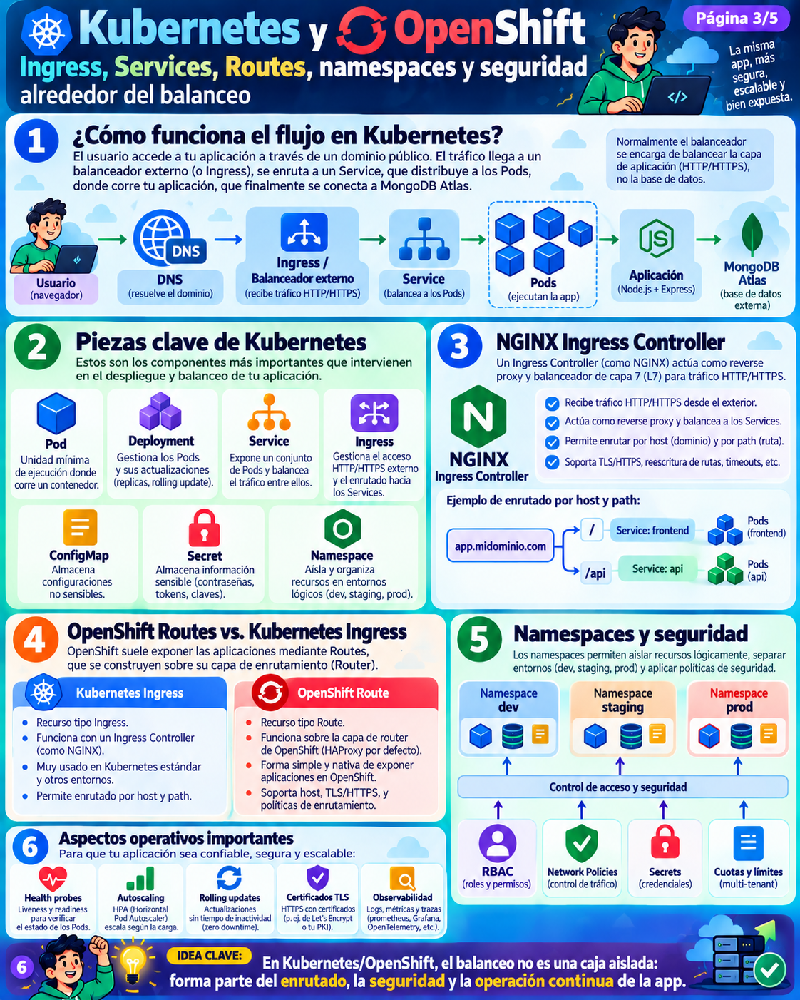
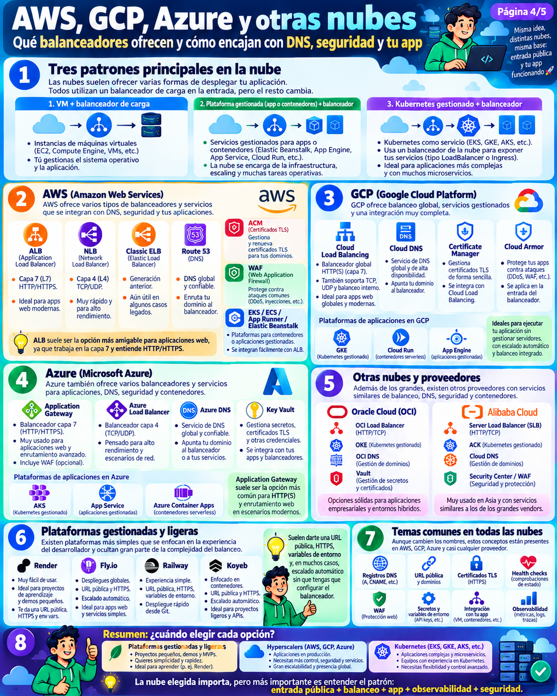
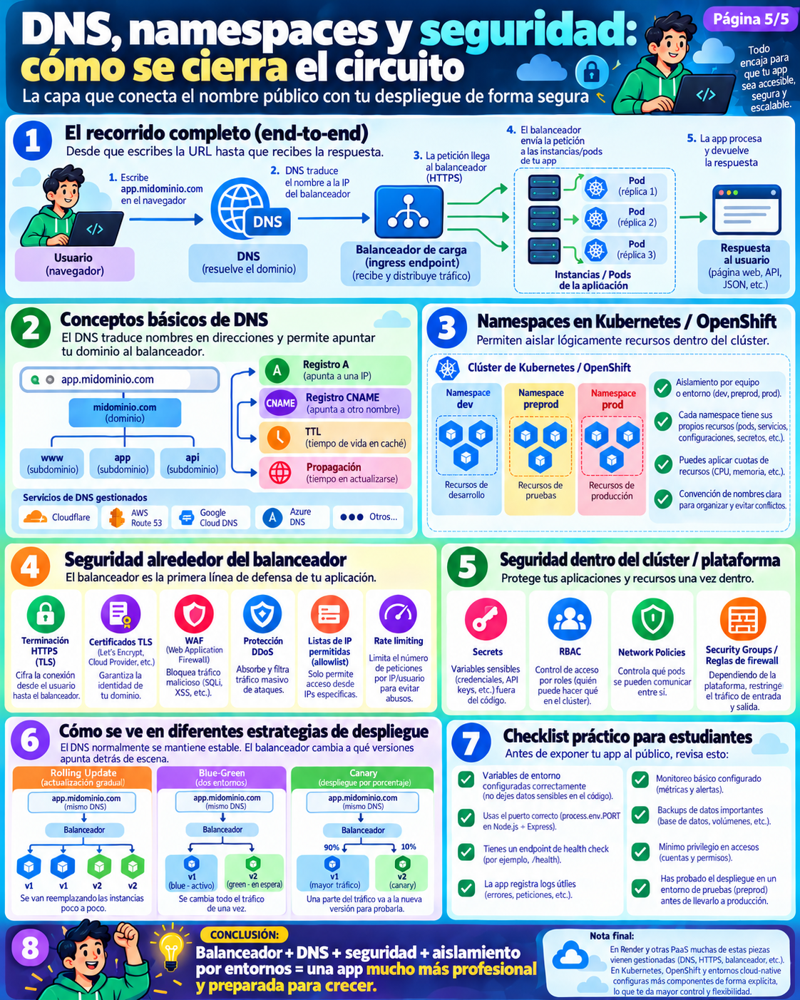

# Módulo 4: Balanceadores de Carga, DNS, Redes y Seguridad en Despliegues
> **La arquitectura invisible que sostiene tu aplicación en Internet: de la resolución de nombres al balanceo de tráfico, aislamiento por namespaces y defensa perimetral.**  
> *Basado en la serie infográfica «Balanceadores de carga, DNS y despliegues» (Páginas 1 a 5).*

---

📍 **Navegación:** [⬅️ Anterior: Módulo 3 (Despliegues Cloud & DevOps)](./03-curso-maestro-despliegues-cloud-devops.md) | [🏠 Volver al README Principal](./README.md) | [Siguiente: Módulo 5 (PostgreSQL vs MongoDB) ➡️](./05-despliegue-postgresql-vs-mongodb.md)

---



---

## 1. El Balanceador de Carga: La Pieza Invisible del Despliegue

Cuando ejecutamos nuestra aplicación To-Do en local con `node awcodeAtlas.js`, el navegador apunta directamente a `localhost:3000`. Sin embargo, en el mundo real nunca exponemos directamente el proceso Node.js a Internet: **situamos un Balanceador de Carga (*Load Balancer*) por delante**.

```
  [ Usuario / Navegador ]
             │  Petición HTTP/S
             ▼
     [ Sistema DNS ] ──▶ Traduce app.midominio.com a la IP pública
             │
             ▼
 ┌───────────────────────────────────────┐
 │       BALANCEADOR DE CARGA            │ ──▶ Punto único de entrada público
 │    (Recibe y distribuye tráfico)      │ ──▶ Terminación TLS/HTTPS y Health Checks
 └──────────────────┬────────────────────┘
                    │ Reparte peticiones solo entre instancias sanas
       ┌────────────┼────────────┐
       ▼            ▼            ▼
   [ Pod 1 ]    [ Pod 2 ]    [ Pod 3 ]     ──▶ Capa Web/App (Node.js + Express + EJS)
   Instancia    Instancia    Instancia
       │            │            │
       └────────────┼────────────┘
                    │ Conexión TCP con credenciales seguras
                    ▼
          [ MongoDB Atlas ]                ──▶ Base de Datos en la Nube
                                               (¡NO se balancea por el load balancer web!)
```

### ¿Por qué el Balanceador es tan Importante?
1. **Alta Disponibilidad:** Si una de las instancias de Node.js colapsa por una excepción no controlada, el balanceador redirige el tráfico a las demás en milisegundos sin interrumpir el servicio.
2. **Escalado Horizontal:** Permite añadir o retirar réplicas del servidor web según la demanda sin cambiar la dirección URL pública que ven los clientes.
3. **Actualizaciones sin Caídas (*Zero Downtime*):** Permite actualizar versiones de la aplicación sin cortar la conexión de ningún usuario.
4. **Comprobaciones de Estado (*Health Checks*):** Pregunta periódicamente a cada instancia si está sana antes de enviarle peticiones.
5. **Terminación TLS/HTTPS:** Gestiona los certificados criptográficos, liberando a Node.js del coste computacional de cifrar y descifrar el tráfico.
6. **Punto Único de Entrada y Observabilidad:** Centraliza logs de tráfico, conteo de peticiones y latencias globales.

> [!NOTE]
> **Aclaración Arquitectónica Fundamental:**  
> El balanceador de carga web distribuye el tráfico HTTP/HTTPS entre las instancias de **Node.js + Express**. La base de datos (**MongoDB Atlas**) no se balancea a través de este componente: Atlas cuenta con su propia red interna y mecanismo de Replica Set gestionado para la replicación y failover de datos.

---

## 2. Tipos de Balanceadores: Capa 4 (L4) vs Capa 7 (L7)

En el modelo OSI de redes, los balanceadores operan principalmente en dos niveles:

```
┌────────────────────────────────────────┬────────────────────────────────────────┐
│         CAPA 4 (TRANSPORTE - L4)       │         CAPA 7 (APLICACIÓN - L7)       │
├────────────────────────────────────────┼────────────────────────────────────────┤
│ • Trabaja a nivel de IP y Puerto       │ • Trabaja a nivel de HTTP / HTTPS / gRPC│
│ • Protocolos: TCP y UDP                │ • Inspecciona URLs, cabeceras y cookies │
│ • No analiza el contenido de la petición│ • Enrutamiento por path (/ y /api)     │
│ • Extremadamente rápido y ligero       │ • Reescribe cabeceras y gestiona SSL   │
│ • Ideal para balanceo masivo de sockets│ • El estándar para apps web modernas   │
│   (ej: AWS NLB, Azure Load Balancer)   │   (ej: NGINX, AWS ALB, Envoy, Traefik) │
└────────────────────────────────────────┴────────────────────────────────────────┘
```

Para nuestra aplicación Express con EJS, **el balanceador de Capa 7 es la elección natural**, ya que comprende las rutas (`/`, `/:customListName`, `/delete`), permite inyectar cabeceras como `X-Forwarded-For` (para conocer la IP real del usuario) y gestionar cookies de sesión.

---



---

## 3. Balanceadores y Estrategias de Despliegue sin Interrupción

El balanceador es el cerebro operativo que hace posibles los despliegues profesionales sin tiempo de inactividad:

### A. Rolling Update (Actualización Progresiva)
Las réplicas se reemplazan de una en una:
1. El balanceador marca la instancia `v1` como "en drenaje" y deja de enviarle nuevas peticiones.
2. Se levanta la nueva instancia con código `v2`.
3. El balanceador ejecuta el *Health Check* (sondeo de salud).
4. Cuando `v2` responde `200 OK`, el balanceador empieza a derivarle tráfico y repite el proceso con la siguiente réplica.

### B. Blue / Green (Conmutación Instantánea)
Se mantienen dos entornos de producción idénticos:
* **Entorno Azul:** Ejecuta la versión actual `v1` y recibe el 100% del tráfico.
* **Entorno Verde:** Ejecuta la nueva versión `v2`, completamente desplegada e integrada con la base de datos para pruebas previas.
* **El Switch:** El balanceador cambia el 100% del tráfico hacia el entorno Verde en un solo segundo. Si surge cualquier fallo inesperado, se revierte de inmediato al entorno Azul (*Instant Rollback*).

### C. Despliegue Canary (Canario)
Permite probar una nueva versión con usuarios reales minimizando el riesgo:
* El 90% del tráfico se mantiene en la versión estable `v1`.
* El 10% del tráfico se desvía a la versión experimental `v2`.
* Se monitorizan los errores HTTP 500 y la latencia. Si los indicadores son óptimos, el balanceador incrementa el tráfico a 50% y finalmente al 100%.

### Funciones Avanzadas del Balanceador
* **Afinidad de Sesión (*Session Stickiness*):** Asegura que las peticiones sucesivas de un mismo usuario vayan a la misma instancia física mediante una cookie o la IP de origen.
* **Sondeos Liveness y Readiness:**
  * *Liveness Probe:* ¿Está el proceso vivo? Si falla, el orquestador reinicia el contenedor.
  * *Readiness Probe:* ¿Está la app lista para aceptar tráfico (por ejemplo, ya conectó a MongoDB Atlas)? Si no lo está, el balanceador no le envía peticiones.
* **Rate Limiting:** Limita el número de peticiones por segundo por IP, protegiendo a Node.js de ataques de fuerza bruta o raspado (*scraping*).
* **WAF (*Web Application Firewall*):** Filtra inyecciones SQL/NoSQL y ataques XSS antes de que toquen el servidor Express.

---



---

## 4. Kubernetes y OpenShift: Ingress, Services, Routes y Namespaces

En entornos nativos de contenedores, el balanceo se organiza en dos capas complementarias:

```
[ Internet ] ──▶ [ Ingress / OpenShift Route ] ──▶ [ Service (ClusterIP) ] ──▶ [ Pods (App Node) ]
                   Balanceo Exterior (L7)           Balanceo Interior (L4)       Contenedores
```

1. **Ingress (Kubernetes):** Objeto que gestiona la entrada desde el exterior, la terminación SSL/TLS y el enrutamiento por nombre de dominio o prefijo de ruta (gestionado típicamente por **NGINX Ingress Controller** o **Traefik**):
   ```
   app.midominio.com/     ──▶ Service Frontend / EJS (Pods de Node)
   app.midominio.com/api  ──▶ Service API REST
   ```
2. **Service (Kubernetes):** Abstracción interna que agrupa los Pods mediante etiquetas (*labels*) y actúa como un balanceador interno con una IP virtual estable dentro del clúster.
3. **OpenShift Routes:** La alternativa nativa de Red Hat OpenShift para exponer servicios al exterior, basada históricamente en un router HAProxy de alto rendimiento con certificados automáticos y políticas avanzadas.

### Aislamiento por Namespaces y Seguridad Interna
Los **Namespaces** permiten particionar un único clúster físico en múltiples entornos virtuales aislados:

```
┌───────────────────────────────── Clúster de K8s / OpenShift ─────────────────────────────────┐
│                                                                                              │
│  [ Namespace: DEV ]             [ Namespace: STAGING ]         [ Namespace: PROD ]           │
│  • Pods de desarrollo          • Pods de preproducción         • Pods de producción          │
│  • ConfigMaps y Secrets dev    • Secrets de staging            • Secrets de prod cifrados    │
│  • Cuotas reducidas de CPU/RAM • Réplicas intermedias          • HPA (Autoscaling) activo    │
│                                                                                              │
│  Seguridad Aplicada:                                                                         │
│  🔒 RBAC: Los desarrolladores tienen permisos limitados en PROD.                             │
│  🛡️ Network Policies: Los pods de DEV no pueden comunicarse con la base de datos de PROD.   │
│  📊 ResourceQuotas: Impide que una fuga de memoria en DEV afecte a PROD.                     │
└──────────────────────────────────────────────────────────────────────────────────────────────┘
```

---



---

## 5. El Catálogo Cloud: Balanceadores y DNS en Hyperscalers y Plataformas Ligeras

Cada proveedor de nube implementa sus propios servicios gestionados para resolver las mismas necesidades de infraestructura:

| Proveedor | Balanceador L7 (Web) | Balanceador L4 (Red) | Servicio DNS | Certificados SSL/TLS | Protección WAF / DDoS |
| :--- | :--- | :--- | :--- | :--- | :--- |
| **AWS** | **ALB** (*Application Load Balancer*) | **NLB** (*Network Load Balancer*) | **Route 53** | **ACM** (*Certificate Manager*) | **AWS WAF** + **AWS Shield** |
| **Google Cloud (GCP)** | **Cloud Load Balancing** | Cloud Load Balancing (TCP) | **Cloud DNS** | **Certificate Manager** | **Google Cloud Armor** |
| **Microsoft Azure** | **Application Gateway** | **Azure Load Balancer** | **Azure DNS** | **Azure Key Vault** | **Azure WAF** + **DDoS Protection** |
| **Oracle Cloud (OCI)** | **OCI Load Balancer** | OCI Network Load Balancer | **OCI DNS** | **OCI Certificates / Vault** | **OCI Web Application Firewall** |
| **Alibaba Cloud** | **Server Load Balancer (SLB)** | SLB (Capa de Transporte) | **Alibaba Cloud DNS** | **SSL Certificates Service** | **Alibaba Cloud Anti-DDoS** |

### ¿Y qué ocurre en plataformas ligeras como Render, Railway o Fly.io?
En plataformas PaaS ligeras, **toda esta complejidad está integrada de forma transparente**:
* Al crear un *Web Service* en Render o Railway, la plataforma provisiona automáticamente un balanceador de carga inverso, gestiona la renovación automática de certificados HTTPS con Let's Encrypt y asigna una URL pública (`https://tu-app.onrender.com`).
* Para proyectos formativos y MVPs, esta abstracción permite centrarse en el código de [`awcodeAtlas.js`](./awcodeAtlas.js) sin tener que configurar reglas complejas de enrutamiento de red.

---



---

## 6. DNS y Seguridad Perimetral: El Recorrido End-to-End

Analicemos qué ocurre en la red desde el momento exacto en que un usuario teclea `https://app.midominio.com` en su navegador hasta que recibe el HTML renderizado con sus tareas de MongoDB:

```
                      EL RECORRIDO COMPLETO (END-TO-END)
                      
 [ 1. Usuario escribe URL ] ──▶ https://app.midominio.com
             │
             ▼
 [ 2. Resolución DNS ]     ──▶ El servidor DNS busca el registro CNAME o A:
                               app.midominio.com ➔ 203.0.113.50 (IP del Balanceador)
             │
             ▼
 [ 3. Llegada al WAF / LB ] ──▶ El Balanceador valida la IP, negocia el cifrado TLS/HTTPS
                               y descarta peticiones con patrones maliciosos.
             │
             ▼
 [ 4. Enrutamiento a Pods ] ──▶ El balanceador elige una instancia sana de Node.js
                               (basándose en Round Robin y Health Probes activas).
             │
             ▼
 [ 5. Ejecución en Express] ──▶ awcodeAtlas.js procesa la petición:
                               • Realiza consulta con Mongoose a MongoDB Atlas.
                               • Renderiza la plantilla EJS con los datos persistidos.
             │
             ▼
 [ 6. Respuesta al Cliente] ──▶ El HTML viaja cifrado de vuelta al navegador.
```

### Conceptos Clave de DNS que Todo Desarrollador Debe Dominar
* **Registro A:** Asocia un nombre de dominio directamente a una dirección IPv4 fija (`app.midominio.com` ➔ `198.51.100.1`).
* **Registro CNAME (*Canonical Name*):** Crea un alias de un dominio hacia otro dominio (`app.midominio.com` ➔ `mi-servicio.onrender.com`). Es el método estándar empleado por casi todas las plataformas PaaS y de nube moderna.
* **TTL (*Time To Live*):** Tiempo en segundos que los servidores DNS y proveedores de Internet almacenan la respuesta en caché. Un TTL bajo (ej. 300 segundos) permite cambiar de servidor rápidamente durante migraciones; un TTL alto reduce la carga de consultas DNS.
* **Propagación:** El intervalo que tarda un cambio en un registro DNS en distribuirse por todos los servidores de nombres del planeta (habitualmente entre 5 minutos y 24 horas).

---

## 7. Checklist de Seguridad y Producción para Estudiantes

Antes de declarar un despliegue como "listo para producción", verifica esta lista de control:

- [ ] **Variables de entorno estrictas:** Cero credenciales o claves de MongoDB Atlas en el código fuente.
- [ ] **Puerto dinámico:** La aplicación lee `process.env.PORT || 3000`.
- [ ] **Endpoint de salud (*Health Check*):** Existe una ruta `/health` o `/` que responda `200 OK` rápidamente sin sobrecargar la base de datos para que el balanceador sepa que la app está viva.
- [ ] **Certificado HTTPS activo:** Ningún formulario sensible de la aplicación viaja sobre HTTP plano.
- [ ] **Gestión de errores asíncronos:** Las desconexiones momentáneas a la base de datos no producen un *crash* del proceso de Node.js.
- [ ] **Aislamiento de entornos:** La base de datos de desarrollo no es la misma base de datos de producción.

---

> [!NOTE]
> **Conclusión del Módulo:**  
> Comprender el balanceo de carga, la resolución DNS y la defensa perimetral transforma al desarrollador de aplicaciones en un **ingeniero de software completo**. Tu código Node.js ya no es una isla en tu ordenador: es un nodo resiliente dentro de un ecosistema distribuido y seguro.

---

📍 **Navegación:** [⬅️ Anterior: Módulo 3 (Despliegues Cloud & DevOps)](./03-curso-maestro-despliegues-cloud-devops.md) | [🏠 Volver al README Principal](./README.md) | [Siguiente: Módulo 5 (PostgreSQL vs MongoDB) ➡️](./05-despliegue-postgresql-vs-mongodb.md)
