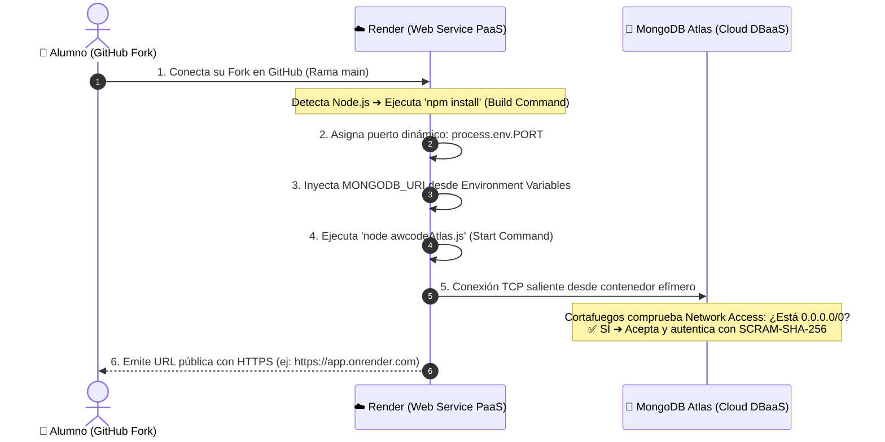

# 🚀 Masterclass Express + Bases de Datos: De la Memoria a la Nube, DevOps y Seguridad
> **Curso integral y práctico sobre persistencia de datos, desarrollo backend con Node.js/Express, MongoDB Atlas vs PostgreSQL vs MySQL, despliegues profesionales (Render, Docker, Kubernetes, GCP Cloud Run, AWS), redes avanzadas (Balanceadores L4/L7, DNS) y ciberseguridad práctica (DevSecOps, Hardening con Helmet, TLS y OWASP).**

---

## 🌟 El Espíritu y Filosofía de este Repositorio

Muchas formaciones web comienzan enseñando listas de tareas (*To-Do Lists*) que guardan datos en variables volátiles en la memoria RAM del servidor (`let items = [...]`). Aunque esto permite entender rutas y peticiones básicas, genera una falsa ilusión de software: **en cuanto el servidor se reinicia o se despliega en la nube, todos los datos desaparecen**.

El objetivo de este repositorio es transformar esa práctica académica básica en una **solución de ingeniería de software real, resiliente y segura**. Centramos todo el aprendizaje en nuestro código estrella:
- [**`awcodeAtlas.js`**](./awcodeAtlas.js) ➔ MongoDB Atlas en la nube (NoSQL).
- [**`awcodePostgres.js`**](./awcodePostgres.js) ➔ PostgreSQL relacional con pools e integridad referencial (SQL).
- [**`awcodeMySQL.js`**](./awcodeMySQL.js) ➔ MySQL en local con auto-creación DDL y compatibilidad de vistas EJS (SQL).
- [**`awcodeMySQLJoin.js`**](./awcodeMySQLJoin.js) ➔ MySQL avanzado con 3 tablas relacionadas, catálogo de urgencias y demostración didáctica de `INNER JOIN` vs `LEFT JOIN`.

Para que el aprendizaje sea visual, intuitivo y riguroso, el curso se apoya en una **colección de 48 infografías de alta resolución** organizadas en [`materiales_didacticos/`](./materiales_didacticos/), articuladas en **ocho módulos formativos exhaustivos**:

```
                                                              MAPA DE LA FORMACIÓN
                                                                        │
   ┌───────────────────┬───────────────────┬───────────────────┬────────┼──────────┬───────────────────┬───────────────────┬───────────────────┬───────────────────┐
   ▼                   ▼                   ▼                   ▼                   ▼                   ▼                   ▼                   ▼                   ▼
[ MÓDULO 1 ]        [ MÓDULO 2 ]        [ MÓDULO 3 ]        [ MÓDULO 4 ]        [ MÓDULO 5 ]        [ MÓDULO 6 ]        [ MÓDULO 7 ]        [ MÓDULO 8 ]
Persistencia vs RAM awcodeAtlas.js      Despliegues Cloud   Balanceadores, DNS  Postgres vs Mongo   Despliegue Seguro   PostgreSQL Arq.     MySQL & Vida Tarea
MongoDB vs SQL      CRUD y Mongoose     Docker, K8s, CI/CD  Namespaces & Redes  awcodePostgres.js   DevSecOps & OWASP   Esquemas, Pass      12 Infografías
```

### 🧭 Enlaces Directos a los Módulos Formativos:
* 📘 **[Módulo 1: Fundamentos de Persistencia y Comparativa NoSQL vs SQL](./materiales_didacticos/01-fundamentos-persistencia-mongo-vs-sql.md)**
* 📗 **[Módulo 2: Curso Práctico - Código awcodeAtlas.js y CRUD Completo](./materiales_didacticos/02-curso-practica-awcodeAtlas-crud-completo.md)**
* 📙 **[Módulo 3: Curso Maestro de Despliegues Cloud, Contenedores y DevOps](./materiales_didacticos/03-curso-maestro-despliegues-cloud-devops.md)**
* 📕 **[Módulo 4: Balanceadores de Carga, DNS, Redes y Seguridad en Despliegues](./materiales_didacticos/04-balanceadores-dns-redes-y-seguridad.md)**
* 📓 **[Módulo 5: Despliegue con PostgreSQL vs MongoDB Atlas (awcodePostgres.js)](./materiales_didacticos/05-despliegue-postgresql-vs-mongodb.md)**
* 🛡️ **[Módulo 6: Despliegue Seguro, DevSecOps y Hardening Web](./materiales_didacticos/06-despliegue-seguro-devsecops-owasp.md)**
* 🐘 **[Módulo 7: PostgreSQL: Arquitectura, Esquemas, Passwords e Inicialización](./materiales_didacticos/07-postgresql-arquitectura-esquemas-passwords.md)**
* 🐬 **[Módulo 8: «La Vida de una Tarea» — Node.js, Express y MySQL (12 Infografías)](./materiales_didacticos/08-curso-maestro-todolist-mysql-infografia.md)**
* 🍃 **[Manual Docente Especial: Clase Maestra NoSQL & MongoDB Atlas](./materiales_didacticos/mongo/CLASE_MAESTRA_MONGODB_NOSQL.md)**
* 🐍 **[Guía Práctica de Laboratorio: MongoDB con Node.js vs Python (PyMongo & Motor)](./materiales_didacticos/mongo/theory/GUIA_PRACTICA_NODE_VS_PYTHON_MONGODB.md)**

---

## 🎯 Guías de Prácticas para Canvas LMS (Evaluables)

El repositorio incluye las plantillas HTML listas para importar en **Canvas LMS** (diseñadas con CSS inline para que Canvas no elimine ningún estilo):

| Práctica | Documento HTML | Enfoque Técnico | Estado |
| :--- | :--- | :--- | :--- |
| **Práctica 1 (Semana Actual)** | [**`practica_despliegue_local.html`**](./practica_despliegue_local.html) | Despliegue Local con MySQL, resolución de puertos (`kill -9`), demostración de `INNER JOIN` vs `LEFT JOIN`, `ON DELETE CASCADE`, mejora con menú desplegable personalizado y arquitectura *Stateless*. | 📌 **Activa** |
| **Práctica 2 (Próxima Semana)** | [**`practica_despliegue_remoto.html`**](./practica_despliegue_remoto.html) | Despliegue en la Nube con **Render** + **MongoDB Atlas**, regla de red `0.0.0.0/0`, variables de entorno (`MONGODB_URI`), prueba multidispositivo 5G y reflexión sobre DBaaS. | 🚀 **Próxima** |

---

## ☁️ Especial Atención: Cómo Preparar el Despliegue en Render (Próxima Práctica)

Aunque la práctica de esta semana se realiza en **local sobre MySQL**, es fundamental que los alumnos comprendan con antelación cómo se desplegará en la nube con **Render** en la siguiente sesión, ya que los conceptos de red e infraestructura se complementan directamente:



### Puntos clave a dominar para Render:
1. **Fork Obligatorio en GitHub:** Render necesita permisos para acceder a un repositorio que pertenezca a la cuenta del propio alumno.
2. **Build Command y Start Command:**
   - *Build Command:* `npm install` (instala dependencias en el contenedor de Render).
   - *Start Command:* `node awcodeAtlas.js` (lanza la versión cloud de la To-Do List).
3. **El puerto dinámico (`process.env.PORT`):** En local solemos fijar el puerto `3000`, pero en Render el balanceador interno asigna un puerto aleatorio mediante la variable de entorno `process.env.PORT`. Nuestro código ya está preparado:
   ```javascript
   const PORT = process.env.PORT || 3000;
   app.listen(PORT, () => console.log("Servidor en puerto", PORT));
   ```
4. **Variables de Entorno Secretas:** La cadena `MONGODB_URI` jamás debe subirse a Git. En Render se añade en la pestaña *Environment Variables*.
5. **El porqué de `0.0.0.0/0` en MongoDB Atlas:** Render asigna IPs públicas dinámicas que cambian en cada despliegue. Si en Atlas solo autorizas tu IP local, el servidor de Render no podrá conectar y el despliegue fallará por *Connection Timeout*. Permitir `0.0.0.0/0` es el estándar en entornos PaaS/Serverless, descansando la seguridad en credenciales criptográficas robustas.

---

## 📚 Estructura Detallada de los Módulos Formativos

### 🐬 [Módulo 8: «La Vida de una Tarea» — Node.js, Express y MySQL (12 Infografías)](./materiales_didacticos/08-curso-maestro-todolist-mysql-infografia.md)
*Deconstrucción profunda de las 12 láminas infográficas de la carpeta [`materiales_didacticos/infografia_app_todolist_mysql/`](./materiales_didacticos/infografia_app_todolist_mysql/).*

* **01. Node.js:** V8 en C++, bindings de sistema operativo y JavaScript fuera del navegador.
* **02. npm y require:** Diferencia entre tiempo de instalación (`node_modules`) y tiempo de ejecución (caché en RAM).
* **03. Arquitectura 3 Capas:** Separación entre Cliente (Navegador), Backend (Express) y Base de Datos (MySQL por puerto 3306).
* **04. Arranque DDL y Pools:** Connection Pool con `mysql2/promise`, creación condicional de BD y tablas, e integridad con `ON DELETE CASCADE`.
* **05. GET / y Sembrado Perezoso:** Comprobación de la lista "Today" y el alias SQL clave `SELECT id AS _id` para compatibilidad de vistas EJS.
* **06. Mapeo SQL a JavaScript:** Transformación de tramas binarias de disco a tipos nativos en el Heap de V8 (`INT` ➔ `Number`, `VARCHAR` ➔ `String`).
* **07. Objetos JS vs JSON:** La diferencia fundamental entre estructuras vivas en memoria RAM y cadenas de texto plano serializadas para la red.
* **08. EJS y Server-Side Rendering (SSR):** Interpolación segura con `<%= %>` contra ataques XSS y modularización con `<%- include %>`.
* **09. Formularios POST y Patrón PRG:** Codificación `application/x-www-form-urlencoded`, prevención de SQL Injection con `?` y por qué usar `res.redirect()` tras un POST para evitar duplicados con F5.
* **10. Borrado Atómico por ID:** El truco del evento `onChange="this.form.submit()"` en checkboxes y borrado por clave primaria indexada.
* **11. Listas Personalizadas y la Regla del Embudo:** Rutas dinámicas (`/:customListName`) y por qué las rutas fijas (`/`, `/comparativa-joins`) deben declararse siempre antes que los comodines para no quedarse congeladas.
* **12. Concurrencia y el Event Loop:** La metáfora del botón de cambiar el color de fondo: por qué `await` pausa solo esa función liberando el hilo principal de Node para seguir atendiendo a otros usuarios.

👉 **[Abrir el Módulo 8 (MySQL y las 12 Infografías)](./materiales_didacticos/08-curso-maestro-todolist-mysql-infografia.md)**

---

### 📘 [Módulo 1: Fundamentos de Persistencia y Criterio de Selección de Bases de Datos](./materiales_didacticos/01-fundamentos-persistencia-mongo-vs-sql.md)
* **Por qué importa persistir:** De una app efímera en memoria a una base de datos duradera.
* **El flujo de datos del cliente a la nube:** Cliente ➔ HTML/CSS/JS ➔ Express ➔ EJS ➔ Mongoose ➔ MongoDB ➔ Atlas.
* **La tríada dorada:** Qué aporta MongoDB (documentos), qué aporta Mongoose (orden) y qué aporta Atlas (infraestructura cloud).
* **Veredicto tecnológico:** Cuándo usar MongoDB, cuándo PostgreSQL, MySQL, Redis o SQLite.

👉 **[Abrir el Módulo 1](./materiales_didacticos/01-fundamentos-persistencia-mongo-vs-sql.md)**

---

### 📗 [Módulo 2: Código awcodeAtlas.js y CRUD Completo](./materiales_didacticos/02-curso-practica-awcodeAtlas-crud-completo.md)
* **Modelado en Mongoose:** Colección `Item` independiente y colección `List` con arrays de **subdocumentos embebidos**.
* **Operaciones CRUD completas:** `GET /`, creación perezosa con `_.capitalize()`, `POST /` con `item.save()` y borrado atómico con `$pull`.

👉 **[Abrir el Módulo 2](./materiales_didacticos/02-curso-practica-awcodeAtlas-crud-completo.md)**

---

### 📙 [Módulo 3: Despliegues Cloud, Contenedores y DevOps](./materiales_didacticos/03-curso-maestro-despliegues-cloud-devops.md)
* **Los tres entornos:** Desarrollo, Staging y Producción.
* **Despliegue en Render, Dockerfiles optimizados en Alpine y Kubernetes:** Pods, Deployments, Services e Ingress.
* **CI/CD con GitHub Actions:** Pipeline automatizado de 9 pasos y estrategias Zero-Downtime.

👉 **[Abrir el Módulo 3](./materiales_didacticos/03-curso-maestro-despliegues-cloud-devops.md)**

---

### 📕 [Módulo 4: Balanceadores de Carga, DNS, Redes y Seguridad](./materiales_didacticos/04-balanceadores-dns-redes-y-seguridad.md)
* **Balanceo L4 vs L7:** TCP/UDP vs HTTP/HTTPS con rutas y cookies de sesión.
* **Estrategias de release:** Rolling Updates, Blue/Green y Canary releases.
* **Resolución DNS End-to-End:** Registros A, CNAME, TTL y tránsito seguro hasta los Pods.

👉 **[Abrir el Módulo 4](./materiales_didacticos/04-balanceadores-dns-redes-y-seguridad.md)**

---

### 📓 [Módulo 5: PostgreSQL vs MongoDB Atlas (awcodePostgres.js)](./materiales_didacticos/05-despliegue-postgresql-vs-mongodb.md)
* **Backend relacional con `pg.Pool`:** Conexiones SSL, `CREATE TABLE IF NOT EXISTS` y relaciones 1:N con `ON DELETE CASCADE`.
* **Matriz Comparativa:** Consistencia ACID, límites de conexiones, migraciones y escalabilidad.

👉 **[Abrir el Módulo 5](./materiales_didacticos/05-despliegue-postgresql-vs-mongodb.md)**

---

### 🛡️ [Módulo 6: Despliegue Seguro, DevSecOps y Hardening Web](./materiales_didacticos/06-despliegue-seguro-devsecops-owasp.md)
* **SQL Injection vs NoSQL Injection en código real.**
* **Análisis de tráfico con Wireshark:** Interceptación de texto plano y cifrado TLS 1.3.
* **Hardening:** Cabeceras HTTP con `helmet`, rate limiting, contenedores no-root y escaneo con Trivy.

👉 **[Abrir el Módulo 6](./materiales_didacticos/06-despliegue-seguro-devsecops-owasp.md)**

---

### 🐘 [Módulo 7: PostgreSQL: Arquitectura, Esquemas, Passwords e Inicialización](./materiales_didacticos/07-postgresql-arquitectura-esquemas-passwords.md)
* **La metáfora del edificio:** Instancia ➔ Base de datos ➔ Esquema ➔ Tablas.
* **El debate de `SCHEMA` vs `NAMESPACE`:** Código C de PostgreSQL (`pg_namespace`) y ANSI SQL-92.
* **Misterio de `search_path` y `public`:** Gestión de contraseñas de roles y scripts de automatización con Python.

👉 **[Abrir el Módulo 7](./materiales_didacticos/07-postgresql-arquitectura-esquemas-passwords.md)**

---

## 🛠️ Guías Rápidas de Apoyo Técnico para MySQL

En [`materiales_didacticos/mysql_guias_apoyo/`](./materiales_didacticos/mysql_guias_apoyo/) dispones de soluciones rápidas a dudas técnicas habituales:
- 📄 [01. Migración de PostgreSQL a MySQL (Cheat Sheet de drivers y placeholders)](./materiales_didacticos/mysql_guias_apoyo/01_migracion_postgres_a_mysql.md)
- 📄 [02. Laboratorio Didáctico de JOINs (INNER vs LEFT JOIN y Retos para alumnos)](./materiales_didacticos/mysql_guias_apoyo/02_ejercicio_avanzado_joins.md)
- 📄 [03. Ciclo de Vida de Node, Liberación de Puertos y Enrutamiento en Express](./materiales_didacticos/mysql_guias_apoyo/03_reinicio_node_y_enrutamiento_express.md)
- 📄 [04. Resolución Didáctica Paso a Paso de Errores y Bugs Comunes](./materiales_didacticos/mysql_guias_apoyo/04_resolucion_paso_a_paso_bugs.md)

---

## ⚡ Guía Rápida de Arranque en Local

### 1. Clonar el repositorio (o tu Fork) e instalar dependencias
```bash
git clone https://github.com/TU_USUARIO/express-mongo-hands-on.git
cd express-mongo-hands-on
npm install
```

### 2. Iniciar el servidor según la versión que quieras probar

* **🐬 Opción A: MySQL en Local (Práctica Semana Actual)**
  ```bash
  # Versión base con 2 tablas:
  npm run start:mysql         # ejecuta node awcodeMySQL.js

  # Versión avanzada con 3 tablas, Urgencias y JOINs:
  npm run start:mysql:join    # ejecuta node awcodeMySQLJoin.js
  ```

* **🍃 Opción B: MongoDB Atlas en la Nube (Práctica Siguiente Semana)**
  ```bash
  npm start                   # ejecuta node awcodeAtlas.js
  ```

* **🐘 Opción C: PostgreSQL en Local / Cloud**
  ```bash
  npm run start:postgres      # ejecuta node awcodePostgres.js
  ```

Abre tu navegador en `http://localhost:3000` y prueba añadir tareas, listas y eliminarlas.

---

## 🖼️ Las 4 Colecciones de Infografías (48 Láminas en Total)

Todas las infografías originales en alta resolución se encuentran organizadas en carpetas temáticas dentro de [`materiales_didacticos/`](./materiales_didacticos/):

| Colección | Ubicación | Láminas | Temática |
| :--- | :--- | :---: | :--- |
| **Colección 1: MySQL y La Vida de una Tarea** | [`infografia_app_todolist_mysql/`](./materiales_didacticos/infografia_app_todolist_mysql/) | **12** | V8, npm, 3 capas, pools DDL, mapeo SQL, SSR con EJS, POST/PRG, DELETE, rutas dinámicas y Event Loop. |
| **Colección 2: Atlas, Despliegues, Docker y K8s** | [`inforgrafia_despliegue_atlas/`](./materiales_didacticos/inforgrafia_despliegue_atlas/) | **21** | Persistencia vs RAM, CRUD completo, Dockerfiles Alpine, K8s Pods/Services, Hyperscalers, Balanceadores L4/L7 y DNS. |
| **Colección 3: Ciberseguridad y DevSecOps** | [`seguridad_despliegues/`](./materiales_didacticos/seguridad_despliegues/) | **9** | Inyecciones SQL/NoSQL, capturas Wireshark, Helmet, Docker no-root, K8s Pod Security y pipelines seguros. |
| **Colección 4: PostgreSQL Arquitectura y Esquemas** | [`postgres_schemas_passwords_init/`](./materiales_didacticos/postgres_schemas_passwords_init/) | **6** | Metáfora del edificio, roles, esquemas ANSI SQL-92, `search_path`, public y Python seguro. |

---

## 🎓 Conclusión Docente

> **«La meta formativa no es memorizar la API de un framework o la sintaxis de un comando; es adquirir visión sistémica y criterio de ingeniería: saber cómo fluye una petición desde el navegador del usuario hasta un clúster distribuido en la nube, y saber blindar cada salto con rigor profesional.»**
