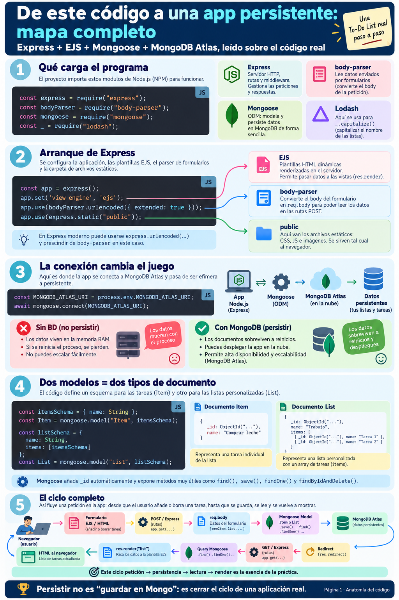
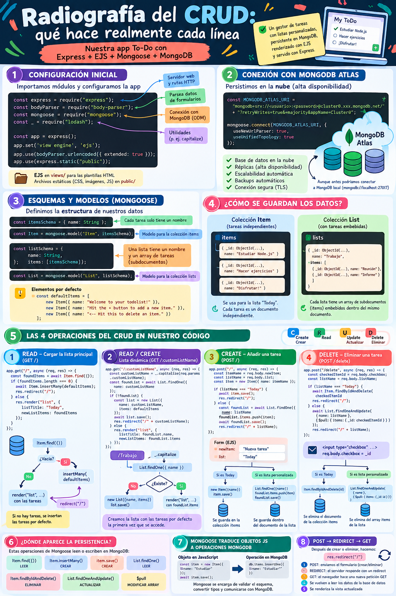
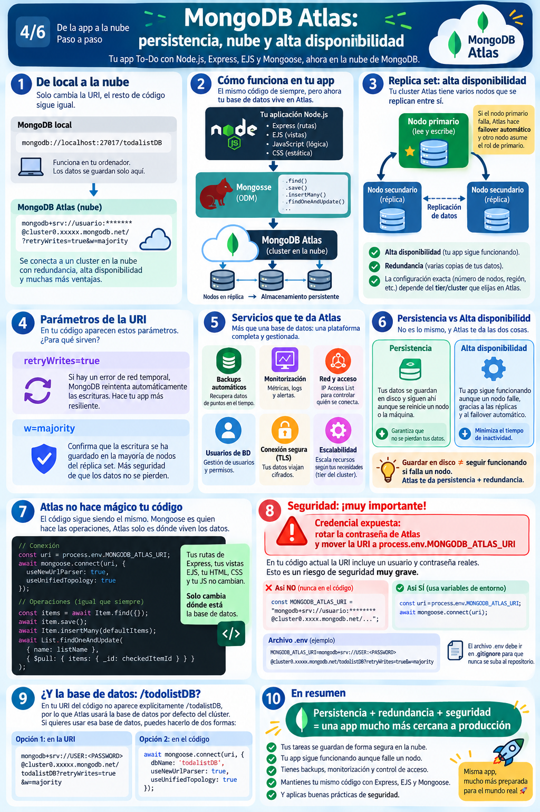

# Módulo 2: Curso Práctico - La Práctica Estrella `awcodeAtlas.js` y el CRUD Completo
> **Deconstrucción pedagógica del To-Do List persistido en MongoDB Atlas mediante Express, EJS y Mongoose.**  
> *Basado en la serie infográfica «De este código a una app persistente: mapa completo» y «Radiografía del CRUD» (Páginas 1 a 6).*

---

📍 **Navegación:** [⬅️ Anterior: Módulo 1](./01-fundamentos-persistencia-mongo-vs-sql.md) | [🏠 Volver al README Principal](./README.md) | [Siguiente: Módulo 3 (Despliegues Cloud & DevOps) ➡️](./03-curso-maestro-despliegues-cloud-devops.md)

---



---

## 1. Introducción: El Alma del Repositorio

El archivo [**`awcodeAtlas.js`**](../awcodeAtlas.js) constituye el núcleo pedagógico de este repositorio. Representa el salto evolutivo desde una práctica académica clásica de To-Do List que guardaba tareas en un array volátil en memoria (`let items = []`), hacia una solución completa y profesional de arquitectura cliente-servidor conectada a un clúster en la nube con **MongoDB Atlas**.

A través de apenas 165 líneas de JavaScript moderno con `async/await`, esta práctica implementa:
1. Conexión segura a un clúster distribuido en la nube.
2. Modelado de datos documental mediante **Mongoose**.
3. Uso simultáneo de **documentos independientes** y **subdocumentos embebidos en arrays**.
4. Operaciones completas de **Lectura (Read), Creación (Create) y Borrado (Delete)**.
5. El patrón de diseño web fundamental **Post-Redirect-Get (PRG)**.
6. Rutas dinámicas mediante parámetros de URL para generar **listas infinitas personalizadas** (`/:customListName`).

---

## 2. Anatomía del Código Paso a Paso

Examinemos la arquitectura del fichero [**`awcodeAtlas.js`**](../awcodeAtlas.js) dividido en sus fases de ejecución:

### Paso 1: Importación de Dependencias
```javascript
//jshint esversion:8
const express = require("express");       // Framework web HTTP para routing y middlewares
const bodyParser = require("body-parser"); // Middleware para parsear el cuerpo de peticiones POST
const mongoose = require("mongoose");     // ODM (Object Data Modeling) para interactuar con MongoDB
const _ = require("lodash");               // Biblioteca de utilidades (utilizada para _.capitalize())
```

* **Express:** Crea la instancia del servidor web y orquesta la entrada y salida de peticiones HTTP.
* **Body-Parser:** Convierte las cargas útiles enviadas mediante formularios HTML (`application/x-www-form-urlencoded`) en objetos JavaScript accesibles en `req.body`.
* **Mongoose:** Establece y gestiona la conexión mediante sockets hacia el clúster de MongoDB, valida esquemas y proporciona la interfaz de consultas.
* **Lodash (`_`):** Proporciona funciones de transformación de datos. Aquí se utiliza `_.capitalize(req.params.customListName)` para asegurar que rutas como `/trabajo`, `/TRABAJO` o `/Trabajo` apunten siempre a la misma entidad canónica `"Trabajo"`.

---

### Paso 2: Configuración del Servidor y Middlewares
```javascript
const app = express();

// Motor de plantillas dinámico en el servidor
app.set('view engine', 'ejs');

// Parseo de formularios y servicio de archivos estáticos
app.use(bodyParser.urlencoded({ extended: true }));
app.use(express.static("public"));
```

```
                              CICLO DE PROCESAMIENTO MIDDLEWARE
                                              │
Petición entrante ──▶ [ express.static("public") ] ──▶ Archivo encontrado? ──▶ Envía CSS/JS
                             │ NO
                             ▼
                      [ bodyParser.urlencoded ] ──▶ Parsea req.body
                             │
                             ▼
                      [ Rutas de Negocio: GET / POST ] ──▶ res.render("list", ...)
```

* `app.set('view engine', 'ejs')`: Le indica a Express que busque archivos con extensión `.ejs` en el directorio [**`views/`**](../views/).
* `app.use(express.static("public"))`: Expone la carpeta [**`public/`**](../public/) para servir hojas de estilo (`css/styles.css`), iconos e imágenes estáticas sin pasar por la lógica de renderizado.

---

### Paso 3: Conexión con MongoDB Atlas y Gestión de Secretos

```javascript
// Cadena de conexión a MongoDB Atlas
const MONGODB_ATLAS_URI = process.env.MONGODB_ATLAS_URI || "mongodb+srv://<usuario>:<password>@cluster0.mongodb.net/todolistDB?retryWrites=true&w=majority";

mongoose.connect(MONGODB_ATLAS_URI, { 
    useNewUrlParser: true, 
    useUnifiedTopology: true 
});
```

> [!CAUTION]
> **Seguridad Crítica:**  
> Jamás debemos dejar usuarios y contraseñas reales hardcodeados en el código que se versiona con Git.  
> La buena práctica profesional consiste en extraer la URI a una variable de entorno (`process.env.MONGODB_ATLAS_URI`), declarar un archivo local `.env` y asegurar que `.env` esté listado explícitamente en [**`.gitignore`**](../.gitignore).

#### Desglose de los parámetros de la URI de Atlas:
* `mongodb+srv://`: Protocolo de servicio DNS (*SRV record*) que descubre automáticamente la topología y los nodos del clúster sin tener que listar cada IP individualmente.
* `retryWrites=true`: Indica al cliente de MongoDB que si una operación de escritura sufre una desconexión de red transitoria, reintente la escritura de forma automática y transparente.
* `w=majority`: Nivel de confirmación de escritura (*Write Concern*). Exige que la escritura sea confirmada por la mayoría de nodos del Replica Set antes de darla por exitosa, garantizando consistencia y durabilidad absoluta de los datos.

---



---

## 3. Modelado de Datos: Documentos Independientes vs Subdocumentos Embebidos

Uno de los aspectos más ricos y didácticos de [**`awcodeAtlas.js`**](../awcodeAtlas.js) es que enseña **dos estrategias distintas de modelado NoSQL** en el mismo ejercicio:

```javascript
// 1. Esquema y Modelo para Tareas Individuales
const itemsSchema = {
    name: String
};
const Item = mongoose.model("Item", itemsSchema);

// 2. Elementos semilla por defecto para listas recién creadas
const item1 = new Item({ name: "Welcome to your todolist!" });
const item2 = new Item({ name: "Hit the + button to add a new item." });
const item3 = new Item({ name: "<-- Hit this to delete an item." });
const defaultItems = [item1, item2, item3];

// 3. Esquema y Modelo para Listas Personalizadas (con documentos embebidos)
const listSchema = {
    name: String,
    items: [itemsSchema] // Array de subdocumentos embebidos
};
const List = mongoose.model("List", listSchema);
```

### ¿Cómo se almacenan físicamente en MongoDB?

#### A. Colección `items` (Para la lista principal "Today"):
Cada tarea es un documento aislado de primer nivel en la colección `items`:
```json
{
  "_id": ObjectId("6501a1b2c3d4e5f6a7b8c9d0"),
  "name": "Comprar leche",
  "__v": 0
}
```

#### B. Colección `lists` (Para listas personalizadas como `/Trabajo` o `/Viajes`):
Una lista es un documento padre que contiene en su campo `items` un array de subdocumentos embebidos, cada uno con su propio `_id`:
```json
{
  "_id": ObjectId("6501a1b2c3d4e5f6a7b8c9d1"),
  "name": "Trabajo",
  "items": [
    {
      "_id": ObjectId("6501a1b2c3d4e5f6a7b8c9d2"),
      "name": "Reunión con el equipo de DevOps"
    },
    {
      "_id": ObjectId("6501a1b2c3d4e5f6a7b8c9d3"),
      "name": "Revisar logs en Atlas"
    }
  ],
  "__v": 0
}
```

---

## 4. Radiografía Completa del CRUD en las Rutas

Analicemos minuciosamente las cuatro rutas que componen el ciclo de vida de la aplicación:

```
┌───────────────────────────┬────────┬────────────────────────────┬─────────────────────────────┐
│ Ruta Express              │ Método │ Operación CRUD             │ Método Mongoose Principal   │
├───────────────────────────┼────────┼────────────────────────────┼─────────────────────────────┤
│ `/`                       │ GET    │ Read (+ Seed inicial)      │ `Item.find({})`             │
│ `/:customListName`        │ GET    │ Read / Create lista        │ `List.findOne()`            │
│ `/`                       │ POST   │ Create tarea (Today / Sub) │ `item.save()` / `push()`    │
│ `/delete`                 │ POST   │ Delete tarea (Today / Sub) │ `findByIdAndDelete` / `$pull`│
└───────────────────────────┴────────┴────────────────────────────┴─────────────────────────────┘
```

---

### Ruta 1: `GET /` — Lectura de la Lista Principal con Auto-Seeding

```javascript
app.get("/", async (req, res) => {
    try {
        const foundItems = await Item.find({});
        if (foundItems.length === 0) {
            // Si la base de datos está vacía, sembramos datos iniciales
            await Item.insertMany(defaultItems);
            res.redirect("/");
        } else {
            // Renderizamos la plantilla EJS pasando los documentos recuperados
            res.render("list", { listTitle: "Today", newListItems: foundItems });
        }
    } catch (err) {
        console.log(err);
        res.status(500).send("Error retrieving items");
    }
});
```

#### Diagrama de Flujo:
```
           [ Petición GET / ]
                   │
                   ▼
          Item.find({}) en Atlas
                   │
           ¿foundItems.length === 0?
            ├── SÍ ──▶ Item.insertMany(defaultItems) ──▶ res.redirect("/")
            │
            └── NO ──▶ res.render("list", { listTitle: "Today", newListItems })
```

* Si la base de datos es nueva o ha sido vaciada, `Item.insertMany(defaultItems)` la inicializa con tareas de ayuda y ejecuta un `res.redirect("/")`.
* Al redirigir, la petición vuelve a entrar, pasa por la rama `else` y renderiza la vista `list.ejs` garantizando una experiencia de usuario impecable desde el primer arranque.

---

### Ruta 2: `GET /:customListName` — Parámetros de Ruta Dinámicos y Creación Perezosa

```javascript
app.get("/:customListName", async (req, res) => {
    const customListName = _.capitalize(req.params.customListName);

    try {
        const foundList = await List.findOne({ name: customListName });
        if (!foundList) {
            // Si la lista no existe, la creamos al vuelo con las tareas por defecto
            const list = new List({
                name: customListName,
                items: defaultItems
            });
            await list.save();
            res.redirect("/" + customListName);
        } else {
            // Si ya existe, renderizamos sus tareas existentes
            res.render("list", { listTitle: foundList.name, newListItems: foundList.items });
        }
    } catch (err) {
        console.log(err);
        res.status(500).send("Error finding the list");
    }
});
```

* **Parámetro dinámico `:customListName`:** Permite al usuario navegar a rutas arbitrarias como `/Trabajo`, `/Escuela` o `/Vacaciones`.
* **Normalización con Lodash:** `_.capitalize()` asegura que variaciones ortográficas de mayúsculas/minúsculas no creen registros duplicados accidentales.
* **Creación perozosa (*Lazy initialization*):** No es necesario un formulario previo para «crear una lista». La primera vez que alguien navega a esa URL, se crea el documento en MongoDB y se redirige a sí misma.

---

### Ruta 3: `POST /` — Creación de Nuevas Tareas

```javascript
app.post("/", async (req, res) => {
    const itemName = req.body.newItem; // Extraído del input text del formulario
    const listName = req.body.list;    // Extraído del valor del botón submit

    const item = new Item({ name: itemName });

    if (listName === "Today") {
        await item.save();
        res.redirect("/");
    } else {
        try {
            const foundList = await List.findOne({ name: listName });
            foundList.items.push(item); // Se añade al array de subdocumentos en memoria de Mongoose
            await foundList.save();     // Mongoose persiste el documento completo actualizado
            res.redirect("/" + listName);
        } catch (err) {
            console.log(err);
            res.status(500).send("Error saving the item");
        }
    }
});
```

* En la lista `"Today"`, cada tarea es independiente; por tanto basta con ejecutar `await item.save()`.
* En listas personalizadas, localizamos el documento padre con `findOne({ name: listName })`, añadimos la nueva instancia al array (`foundList.items.push(item)`) y persistimos el cambio con `await foundList.save()`.

---

### Ruta 4: `POST /delete` — Borrado con Operador Atómico `$pull` de MongoDB

```javascript
app.post("/delete", async (req, res) => {
    const checkedItemId = req.body.checkbox; // ID del documento a eliminar
    const listName = req.body.listName;       // Nombre de la lista actual

    try {
        if (listName === "Today") {
            // Borrado de documento de primer nivel
            await Item.findByIdAndDelete(checkedItemId);
            res.redirect("/");
        } else {
            // Borrado atómico de un subdocumento embebido en un array
            await List.findOneAndUpdate(
                { name: listName },
                { $pull: { items: { _id: checkedItemId } } }
            );
            res.redirect("/" + listName);
        }
    } catch (err) {
        console.log(err);
        res.status(500).send("Error deleting the item");
    }
});
```

> [!TIP]
> **La joya técnica del borrado: el operador `$pull` de MongoDB**  
> Cuando eliminamos un elemento de una lista personalizada, no tenemos que traernos toda la lista a la memoria de Node, buscar el índice del array y volver a guardarla.  
> Con `List.findOneAndUpdate({ name: listName }, { $pull: { items: { _id: checkedItemId } } })`, le ordenamos a MongoDB directamente en el servidor de base de datos que busque dentro del array `items` aquel subdocumento cuyo `_id` coincida con `checkedItemId` y lo extirpe de forma atómica y concurrente.

---



---

## 5. El Patrón Post-Redirect-Get (PRG)

Observa que tanto en `app.post("/")` como en `app.post("/delete")`, el servidor **nunca renderiza directamente el HTML** en la respuesta (`res.render(...)`), sino que responde con una redirección HTTP 302 (`res.redirect(...)`).

```
                              PATRÓN POST-REDIRECT-GET (PRG)
                              
  [ Navegador ]                                       [ Servidor Express ]
        │                                                      │
        │─── 1. POST / (añadir tarea "Comprar pan") ──────────▶│
        │                                                      │── Persiste en MongoDB Atlas
        │◀── 2. HTTP 302 Redirect (Location: "/") ─────────────│
        │                                                      │
        │─── 3. GET / ────────────────────────────────────────▶│
        │                                                      │── Consulta Item.find({})
        │◀── 4. HTTP 200 OK (HTML renderizado con nueva tarea)─│
```

### ¿Por qué es crucial enseñar este patrón a los alumnos?
1. **Evita la duplicación accidental de envíos:** Si el servidor respondiera al `POST` con HTML directamente, al pulsar el usuario `F5` o el botón de refrescar en el navegador, el navegador mostraría la clásica advertencia: *«¿Desea volver a enviar el formulario?»*. Si el usuario acepta, se crearía una tarea duplicada.
2. **Historial de navegación limpio:** Con PRG, la última acción registrada en el historial del cliente es una petición idempotente `GET`, permitiendo retroceder y avanzar en el navegador sin efectos secundarios.

---

## 6. Mongoose en Acción: Traducción de Métodos a Operaciones MongoDB

| Método en Mongoose | Operación Nativa en MongoDB Driver | Propósito en el Código |
| :--- | :--- | :--- |
| `Item.find({})` | `db.items.find({})` | Recupera todos los documentos de tareas. |
| `Item.insertMany(docs)` | `db.items.insertMany(docs)` | Siembra masiva de las tareas semilla iniciales. |
| `item.save()` | `db.items.insertOne(doc)` | Inserta una nueva tarea individual. |
| `List.findOne({ name })` | `db.lists.findOne({ name })` | Encuentra una lista personalizada por su nombre. |
| `Item.findByIdAndDelete(id)` | `db.items.deleteOne({ _id: ObjectId(id) })` | Elimina la tarea de la lista Today por su identificador único. |
| `List.findOneAndUpdate(..., { $pull })` | `db.lists.updateOne(..., { $pull })` | Elimina atómicamente un subdocumento de un array sin tocar los demás. |

---

## 7. Buenas Prácticas de Refactorización y Producción

Al revisar el código con mentalidad docente y profesional, podemos identificar mejoras que elevan la calidad técnica del proyecto:

1. **Gestión de variables de entorno:**  
   Reemplazar la URI hardcodeada por `process.env.MONGODB_ATLAS_URI` y configurar la librería `dotenv`:
   ```javascript
   require('dotenv').config();
   const MONGODB_ATLAS_URI = process.env.MONGODB_ATLAS_URI;
   ```
2. **Definición de Schemas con tipos formales:**  
   En lugar de objetos planos `{ name: String }`, utilizar la clase formal `new mongoose.Schema({ name: { type: String, required: true } })`.
3. **Manejo uniforme de errores asíncronos:**  
   Utilizar bloques `try/catch` bien estructurados o middlewares de manejo de errores globales en Express para garantizar que ningún fallo de red en la base de datos tire el servidor Node.

---

📍 **Navegación:** [⬅️ Anterior: Módulo 1](./01-fundamentos-persistencia-mongo-vs-sql.md) | [🏠 Volver al README Principal](./README.md) | [Siguiente: Módulo 3 (Despliegues Cloud & DevOps) ➡️](./03-curso-maestro-despliegues-cloud-devops.md)
