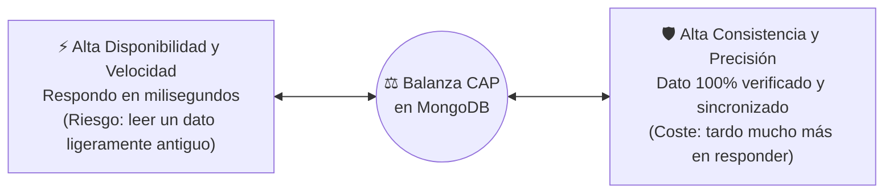
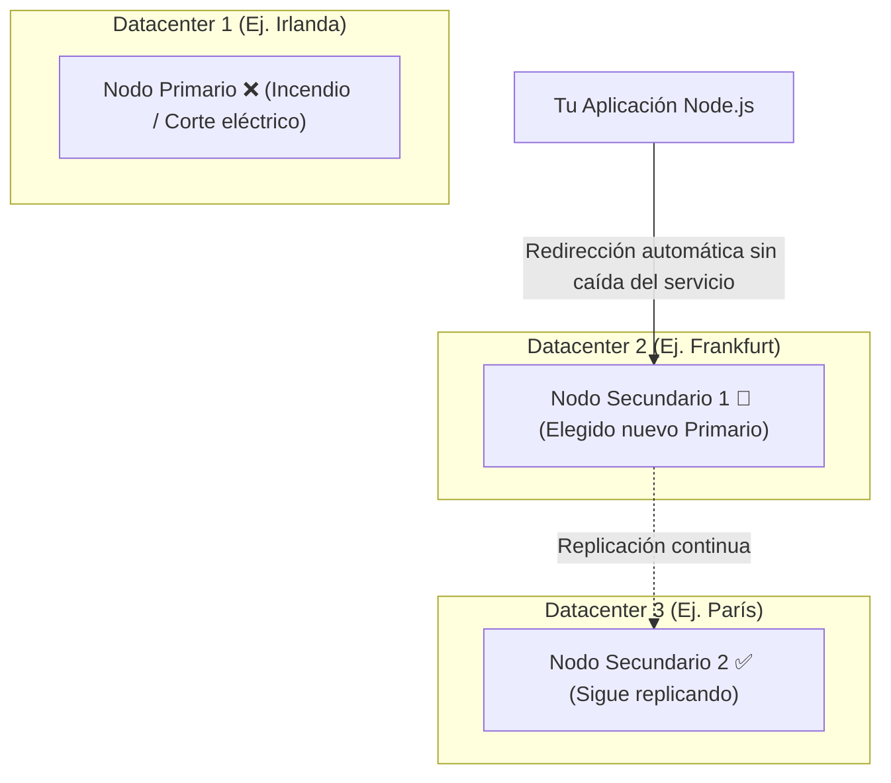

# 📝 Resumen de Clase: Salto a MongoDB Atlas, Teorema CAP, Consistencia vs. Disponibilidad y Alta Disponibilidad (HA)

> **Apuntes de repaso de la sesión del martes 10 (especialmente pensados para consolidar ideas y para quienes no pudisteis asistir a clase).**  
> *Más allá de la sintaxis del CRUD: cómo pensar como un ingeniero de software ante el equilibrio entre velocidad, precisión, replicación y supervivencia ante desastres.*

---

## 🧭 Índice de la Sesión

1. [Calentamiento: Resolución de dudas sobre `JOIN`, `LEFT JOIN` y Git](#1-calentamiento-resolución-de-dudas-sobre-join-left-join-y-git)
2. [Aterrizaje en MongoDB Atlas y CRUD desde Node.js](#2-aterrizaje-en-mongodb-atlas-y-crud-desde-nodejs)
   - 2.1. Las operaciones principales de CRUD en MongoDB
   - 2.2. La idea clave: el CRUD es el mismo que en MySQL, solo cambia cómo se pide
3. [El verdadero núcleo: Consistencia, Disponibilidad y el Teorema CAP](#3-el-verdadero-núcleo-consistencia-disponibilidad-y-el-teorema-cap)
   - 3.1. ¿Qué dice el Teorema CAP y a qué se reduce hoy en día?
   - 3.2. La balanza modulable de MongoDB: los quórums entre réplicas
4. [Replicación y Alta Disponibilidad (HA): ¿Por qué complicarnos la vida?](#4-replicación-y-alta-disponibilidad-ha-por-qué-complicarnos-la-vida)
   - 4.1. El coste de replicar frente a la supervivencia ante desastres
   - 4.2. HA no es lo mismo que velocidad... y tampoco sustituye a un Backup
   - 4.3. Criterio de ingeniería: ¿cuánto valen realmente tus datos?
5. [Pincelada intuitiva: OLTP frente a OLAP](#5-pincelada-intuitiva-oltp-frente-a-olap)
6. [Reflexión final: aprender ingeniería haciendo](#6-reflexión-final-aprender-ingeniería-haciendo)

---

## 1. Calentamiento: Resolución de dudas sobre `JOIN`, `LEFT JOIN` y Git

Antes de meternos de lleno en el mundo NoSQL, dedicamos la primera parte de la clase a despejar bloqueos habituales de las prácticas anteriores:

* **`INNER JOIN` vs. `LEFT JOIN` (MySQL):**
  * Con un `INNER JOIN` solo aparecen las filas que tienen coincidencia en **ambas** tablas. Si una tarea no tiene prioridad asignada (`NULL`), desaparece del resultado.
  * Con un `LEFT JOIN` conservamos **todas** las filas de la tabla de la izquierda (por ejemplo, todas las tareas), aunque en la tabla de la derecha no exista coincidencia (en ese caso rellena con `NULL`).
* **Uso práctico de Git en clase:**
  * Repasamos la diferencia entre hacer un **Fork** (copia propia en tu cuenta de GitHub para poder modificar y desplegar sin pisar el repo original) y un **Clone** (descargar ese repositorio a tu ordenador).
  * Repasamos el ciclo básico de trabajo seguro: `git status` → `git add` → `git commit` → `git push`, evitando trabajar a ciegas o subir archivos innecesarios como `node_modules/`.

---

## 2. Aterrizaje en MongoDB Atlas y CRUD desde Node.js

El plato fuerte de la sesión fue dar el salto a **MongoDB** para prepararnos de cara a la práctica en la nube:
1. Todos configuramos nuestra cuenta y desplegamos un clúster gratuito en **MongoDB Atlas** (base de datos como servicio, sin tener que instalar el motor en nuestro portátil).
2. Conectamos desde código **JavaScript ejecutado en Node.js** para empezar a realizar operaciones **CRUD** (*Create, Read, Update, Delete*) contra la base de datos en la nube.

### 2.1. Las principales operaciones de CRUD en MongoDB

| Operación | Equivalente en MySQL | En MongoDB (Node.js) | Ejemplo rápido |
| :--- | :--- | :--- | :--- |
| **Create** (Crear) | `INSERT INTO ...` | `insertOne()` / `insertMany()` | `await col.insertOne({ name: "Estudiar CAP" })` |
| **Read** (Leer) | `SELECT ... WHERE ...` | `find()` / `findOne()` | `await col.findOne({ name: "Estudiar CAP" })` |
| **Update** (Actualizar) | `UPDATE ... SET ...` | `updateOne()` / `updateMany()` | `await col.updateOne({ _id: id }, { $set: { done: true } })` |
| **Delete** (Borrar) | `DELETE FROM ...` | `deleteOne()` / `deleteMany()` | `await col.deleteOne({ _id: id })` |

### 2.2. La idea clave: no te obsesiones con el CRUD

> [!IMPORTANT]
> **El CRUD es exactamente el mismo concepto que ya conocías en MySQL.**  
> Crear, leer, actualizar y borrar datos es universal. Lo único que cambia es *el idioma con el que se lo pides al motor* (objetos JSON/BSON y métodos JavaScript en lugar de sentencias SQL).  
> Por eso, la sintaxis del CRUD se consulta en la documentación en 10 segundos; **lo que de verdad marca la diferencia como ingeniero está un nivel por encima**: entender cómo se comportan los datos cuando viven distribuidos en varios servidores.

---

## 3. El verdadero núcleo: Consistencia, Disponibilidad y el Teorema CAP

### 3.1. ¿Qué dice el Teorema CAP y a qué se reduce hoy en día?

El famoso **Teorema CAP** establece que en un sistema distribuido (varios servidores trabajando juntos por red) solo puedes garantizar simultáneamente **dos** de estas tres propiedades:

* **C — Consistency (Consistencia / Precisión):** Todos los nodos ven exactamente el mismo dato en el mismo instante. Si escribes un cambio, cualquier lectura posterior verá ese cambio seguro.
* **A — Availability (Disponibilidad / Velocidad):** El sistema siempre responde a cualquier petición sin errores y lo más rápido posible, aunque algún nodo vaya retrasado.
* **P — Partition Tolerance (Tolerancia a Particiones):** El sistema sigue funcionando aunque se corte o degrade la comunicación de red entre dos servidores.

En la práctica moderna en la nube (donde las redes **siempre** pueden fallar o sufrir microcortes), la **P** no es opcional: hay que soportarla sí o sí. Por eso, hoy en día el debate CAP se reduce intuitivamente a **una balanza entre Velocidad (Disponibilidad) frente a Precisión (Consistencia)**:

* Si quieres **máxima consistencia**, el servidor no puede contestarte hasta confirmar que las copias están sincronizadas → **tardas mucho más en responder**.
* Si quieres **máxima velocidad**, el servidor te contesta en cuanto lo anota en un nodo → **vas rapidísimo**, pero asumes que otra réplica puede tardar unos milisegundos en enterarse (*consistencia eventual*).

---

### 3.2. La balanza modulable de MongoDB: los quórums entre réplicas

Aquí es donde **MongoDB da muchísimo juego**: no te obliga a elegir un único extremo para siempre, sino que te permite **regular la balanza** ajustando el **quórum** (cuántas réplicas deben ponerse de acuerdo) en cada operación:

* **Al escribir (`writeConcern`):**
  * `w: 1` → **Rápido:** el nodo Primario guarda el dato y te responde al instante, sin esperar a las réplicas.
  * `w: "majority"` → **Seguro / Consistente:** el Primario espera a que la **mayoría de réplicas** (quórum, ej. 2 de 3 nodos) confirmen que tienen el dato antes de darte el OK. Es más lento, pero garantiza que el dato no se evaporará si el Primario falla un segundo después.
* **Al leer (`readConcern`):**
  * `"local"` → **Rápido:** devuelve lo que tenga el nodo en ese instante, aunque aún no esté confirmado por el quórum.
  * `"majority"` → **Preciso:** solo devuelve datos que ya han sido confirmados por la mayoría del clúster.

---

## 4. Replicación y Alta Disponibilidad (HA): ¿Por qué complicarnos la vida?

### 4.1. El coste de replicar frente a la supervivencia ante desastres

Montar un sistema replicado (como un *Replica Set* en MongoDB Atlas) **no es gratis**:
* **Hace perder velocidad** (hay que copiar datos por la red entre máquinas y coordinar confirmaciones).
* **Es un follón operativo** (hay que mantener nodos sincronizados, vigilar latidos o *heartbeats*, gestionar votaciones si cae el líder, evitar conflictos...).

Entonces, **¿por qué aguantamos toda esa complejidad?**  
Para conseguir **HA (*High Availability* / Alta Disponibilidad)**:

### 4.2. HA no es lo mismo que velocidad... y tampoco sustituye a un Backup

Conviene tener muy claras dos distinciones fundamentales que comentamos en clase:

1. **HA ≠ "tener el dato rápido":**  
   Cuando hablamos de **Alta Disponibilidad**, el objetivo principal no es ganar velocidad, sino **seguir teniendo el dato y el sistema vivo aunque ocurra un desastre en un datacenter**, porque existe una copia activa en otro servidor o en otro datacenter distinto.
2. **HA ≠ Backup (la prueba del misil):**  
   > *«Con un misil a cada datacenter tiramos el sistema igual... y ahí es donde es imprescindible tener un **Backup**.»*
   
   Además del escenario extremo de perder todos los datacenters a la vez, piensa en un error humano o un ataque: si alguien ejecuta por error un `deleteMany({})` o un ransomware borra tus colecciones, **la replicación copiará ese borrado a todos los nodos en milisegundos**. La HA te protege contra **caídas de hardware/red**, mientras que el **Backup** (copia histórica congelada y aislada) te protege contra **destrucción total o borrados lógicos**.

### 4.3. Criterio de ingeniería: ¿cuánto valen realmente tus datos?

Un buen ingeniero no aplica la arquitectura más compleja del mundo por defecto, sino que evalúa el **valor del dato**:
* Para una app de notas o una práctica de clase, no tiene sentido volverse loco pagando réplicas intercontinentales y consistencia linealizable.
* Para un banco, un historial clínico o una pasarela de pagos, perder un solo registro o caer 10 minutos es inasumible, y ahí sí se justifica invertir en quórums estrictos, multi-datacenter y backups redundantes.

---

## 5. Pincelada intuitiva: OLTP frente a OLAP

Al hablar del equilibrio entre **velocidad** y **análisis/precisión**, suele aparecer otra pareja clásica de siglas en bases de datos con la que conviene quedarse con la idea intuitiva:

| Concepto | ¿Qué significa? | Intuición práctica | Ejemplo cotidiano |
| :--- | :--- | :--- | :--- |
| **OLTP** | *Online Transaction Processing* | **El día a día en tiempo real.** Miles de operaciones pequeñas, rápidas y concurrentes (leer, insertar, actualizar un registro concreto). | Añadir una tarea a tu To-Do List, comprar una entrada de cine, hacer un Bizum. |
| **OLAP** | *Online Analytical Processing* | **Mirar la foto grande e histórica.** Pocas consultas, pero muy pesadas, cruzando millones de datos acumulados para sacar estadísticas y decisiones de negocio. | *"¿Qué productos se vendieron más en invierno durante los últimos 5 años por provincia?"* |

* **MongoDB** y **MySQL** en nuestras aplicaciones web están actuando típicamente como motores **OLTP** (necesitamos responder rápido al usuario que pulsa un botón).
* Cuando una empresa necesita hacer analítica pesada (**OLAP**), suele llevar una copia de los datos a un almacén especializado (*Data Warehouse* como BigQuery, Snowflake o ClickHouse) para no ralentizar la base de datos que atiende a los usuarios en vivo.

---

## 6. Reflexión final: aprender ingeniería haciendo

A veces la teoría pura de sistemas distribuidos (CAP, quórums, replicación, HA) resulta dura y abstracta si solo se lee en diapositivas. Sin embargo, cuando despliegas tu propia app con Node.js y MongoDB Atlas, ves que funciona de verdad y **miramos cada concepto justo cuando lo necesitamos**, la ingeniería de software empieza a generar esa *endorfina* que hace que todo encaje poco a poco.

Quédate con los pilares clave de esta clase —**disponibilidad, consistencia, replicación y el valor de tus datos**— porque las librerías cambiarán dentro de cinco años, pero estas decisiones arquitectónicas te acompañarán toda tu carrera.

*Poco a poco... ¡y ya puedes tachar un punto más de tu lista de tareas!* ✅
