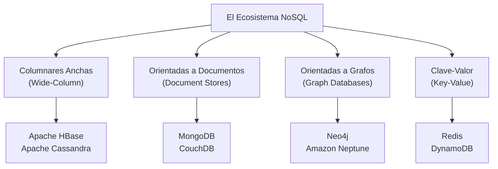
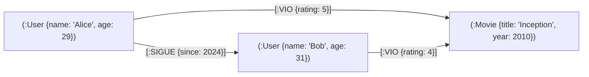
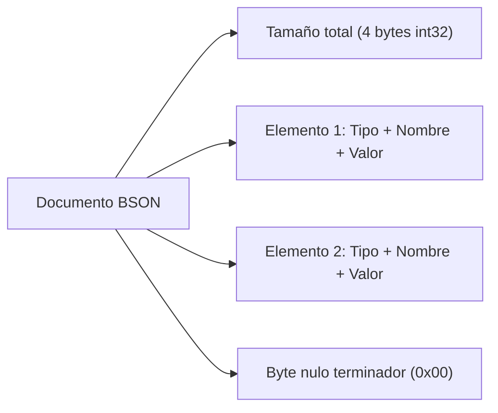
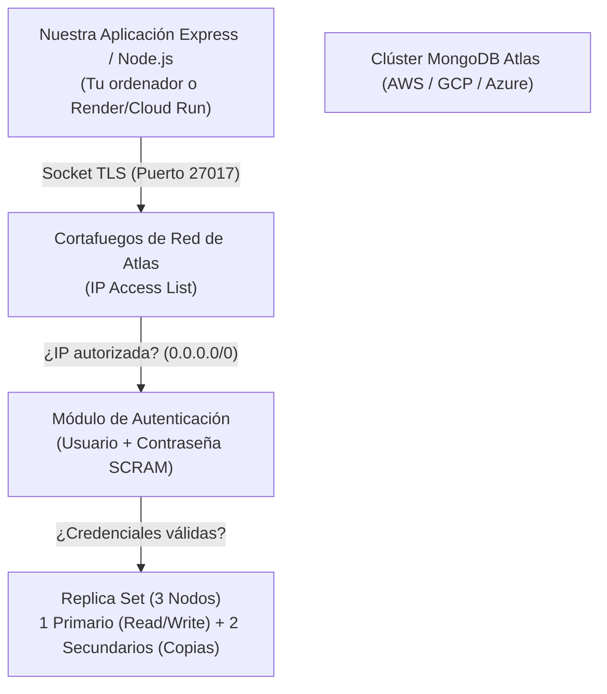
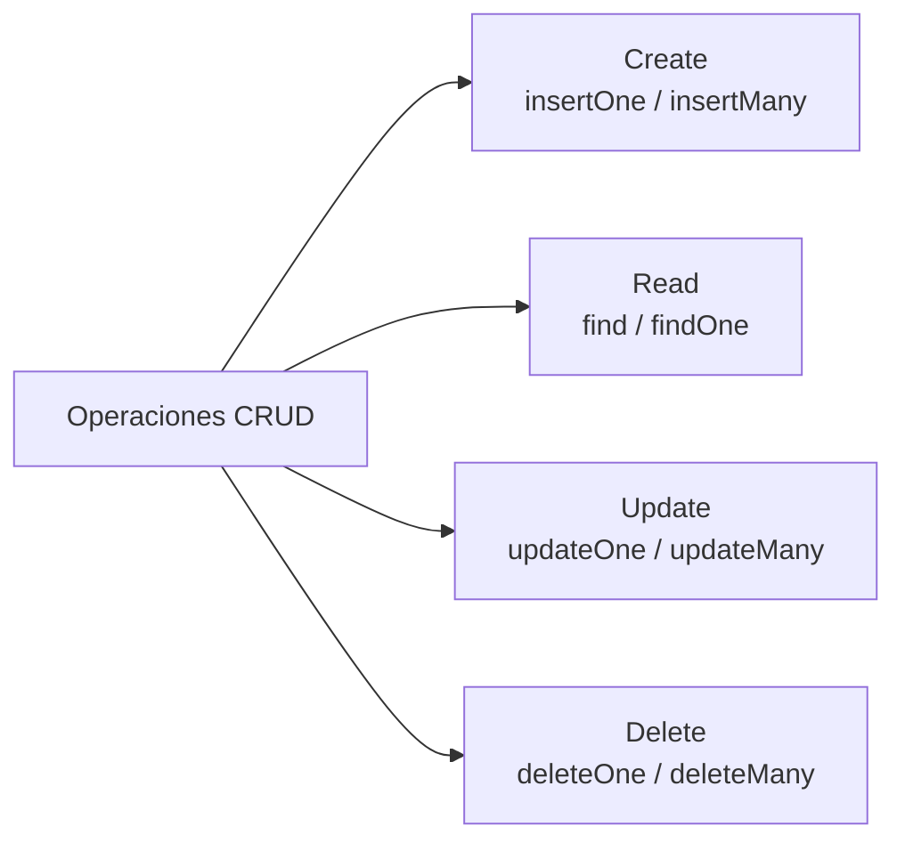
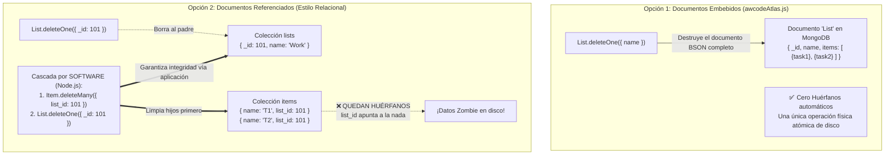

# 🎓 Manual Maestro: Del Horizonte NoSQL a MongoDB Atlas con Node.js y Mongoose
> **Guía integral y manual de laboratorio práctico.**  
> *De los fundamentos teóricos de las bases NoSQL (HBase, Cassandra, Neo4j, MongoDB) y la ingeniería interna de BSON/JSON, hasta el despliegue cloud en Atlas, el análisis código a código de la suite de scripts, el debate arquitectónico: Embebido vs Referenciado, y el apéndice sobre cascada y borrado de listas.*

---

## 🧭 Índice General del Manual

1. [Bloque 1: Más allá del Modelo Relacional — Taxonomía NoSQL](#-bloque-1-más-allá-del-modelo-relacional--taxonomía-nosql)
   - 1.1. Las limitaciones del RDBMS frente al Big Data y la agilidad moderna
   - 1.2. Bases de Datos Columnares Anchas (*Wide-Column*): Apache HBase (con y sin Apache Phoenix)
   - 1.3. Modelo Distribuido Descentralizado: Apache Cassandra y CQL
   - 1.4. Bases de Datos Orientadas a Grafos: Neo4j y el lenguaje Cypher
   - 1.5. Bases de Datos Orientadas a Documentos: El reino de MongoDB
2. [Bloque 2: La Ingeniería de los Documentos — JSON vs BSON](#-bloque-2-la-ingeniería-de-los-documentos--json-vs-bson)
   - 2.1. Anatomía de un documento MongoDB
   - 2.2. Por qué JSON en texto plano es ineficiente en disco y red
   - 2.3. BSON al microscopio: Tipos binarios, longitud prefijada y saltos rápidos
   - 2.4. El dilema de las claves repetidas: Comparativa y órdenes de magnitud
3. [Bloque 3: Infraestructura Cloud — Guía Paso a Paso en MongoDB Atlas](#-bloque-3-infraestructura-cloud--guía-paso-a-paso-en-mongodb-atlas)
   - 3.1. Creación de cuenta y despliegue de un Clúster M0 Free Tier
   - 3.2. Gestión de identidades (Database Access y autenticación SCRAM)
   - 3.3. La regla de fuego de seguridad en red: `0.0.0.0/0` (Network Access)
   - 3.4. Extracción de la cadena de conexión `mongodb+srv://`
4. [Bloque 4: Laboratorio de Código — Recorrido Detallado Script por Script](#-bloque-4-laboratorio-de-código--recorrido-detallado-script-por-script)
   - 4.1. `mongo-cars-basic-driver.js`: El driver nativo oficial de MongoDB
   - 4.2. `mongo-cars-basic-mongoose.js`: La transición al ODM Mongoose
   - 4.3. Debate Técnico: Ventajas e inconvenientes reales de Mongoose
   - 4.4. `mongo-cars.js`: Validaciones de esquema, tipado estricto y ciclo de vida de modelos
   - 4.5. `mongo-cars2.js`: Operadores de consulta avanzados (`$gt`, `$in`, `$regex`), proyecciones y updates
   - 4.6. `mongo-movies.js`: Esquemas flexibles (`{ strict: false }`) sobre datasets reales (`sample_mflix`)
   - 4.7. `mongo-users.js`: El poder de los Subdocumentos Embebidos (Arrays de Objetos con `$push` y `$pull`)
   - 4.8. `movies-native-driver.js` vs `movies-mongoose.js`: Comparativa cara a cara (Driver Nativo vs ODM)
5. [Bloque 5: Arquitectura de Datos — awcodeAtlas.js vs awcodeMySQL](#-bloque-5-arquitectura-de-datos--awcodeatlasjs-vs-awcodemysql)
   - 5.1. ¿Cómo se evita el `JOIN` relacional en MongoDB?
   - 5.2. Opción A: Documentos Embebidos (La vía de `awcodeAtlas.js`)
   - 5.3. Opción B: Referenciación manual por `ObjectId` y el problema de los registros huérfanos
   - 5.4. La ausencia de `ON DELETE CASCADE` en MongoDB y su resolución por software
6. [Resumen Rápido: Cheat Sheet de Operaciones CRUD en MongoDB](#-resumen-rápido-cheat-sheet-de-operaciones-crud-en-mongodb)
7. [Apéndice Especial: La Paradoja del Borrado de Listas en la To-Do List y la Integridad en MongoDB](#-apéndice-especial-la-paradoja-del-borrado-de-listas-en-la-to-do-list-y-la-integridad-en-mongodb)
   - A.1. La realidad de la To-Do List actual: Solo se borran tareas individuales
   - A.2. El experimento mental: ¿Y si quisiéramos borrar una lista entera de un plumazo?
   - A.3. Comparativa: Borrado en modelo Embebido vs Borrado en modelo Referenciado
   - A.4. Validación arquitectónica: El software como garante de la integridad NoSQL

---

## 🏛️ Bloque 1: Más allá del Modelo Relacional — Taxonomía NoSQL

### 1.1. Las limitaciones del RDBMS frente al Big Data y la agilidad moderna
Durante más de tres décadas, las bases de datos relacionales SQL (Oracle, PostgreSQL, MySQL, SQL Server) dominaron la industria. Su modelo, basado en el **Álgebra Relacional de Edgar F. Codd (1970)**, ofrece garantías ACID innegociables (Atomicidad, Consistencia, Aislamiento y Durabilidad).

Sin embargo, a comienzos del siglo XXI la explosión de la Web 2.0 y el Big Data destapó tres cuellos de botella:
1. **Rigidez de Esquema (*Schema Impedance Mismatch*):** En una tabla relacional, todas las filas deben tener exactamente las mismas columnas. Añadir una columna a una tabla de 500 millones de filas en producción bloqueaba el sistema durante horas.
2. **Coste prohibitivo del Escalado Horizontal (*Sharding*):** Las bases de datos SQL están diseñadas fundamentalmente para escalar verticalmente (comprar un servidor con más núcleos de CPU y más Terabytes de RAM). Repartir una base SQL en 100 máquinas distribuidas y mantener la integridad de los `JOIN` y las claves foráneas en red es matemáticamente complejo y sumamente ineficiente.
3. **El Teorema CAP (Eric Brewer):** En un sistema distribuido, solo puedes garantizar simultáneamente dos de estas tres propiedades:
   - **C**onsistency (Consistencia: todos los nodos ven los mismos datos al mismo tiempo).
   - **A**vailability (Disponibilidad: cada petición recibe una respuesta sin error).
   - **P**artition Tolerance (Tolerancia a particiones de red: el sistema sigue operando si se cae la comunicación entre nodos).

Las bases de datos NoSQL nacieron para priorizar **P (Particionamiento)** y balancear entre **C** y **A**, renunciando en muchos casos a la normalización estricta para ganar escalabilidad horizontal casi infinita y esquemas flexibles.



---

### 1.2. Bases de Datos Columnares Anchas (*Wide-Column*): Apache HBase

**Apache HBase** es la implementación de código abierto del mítico artículo de Google sobre **Bigtable (2006)**. Corre sobre el sistema de archivos distribuido de Hadoop (**HDFS**).

#### ¿Cómo almacena los datos?
En lugar de almacenar filas contiguas en disco como MySQL, HBase almacena **Familias de Columnas (*Column Families*)**. Una celda se localiza mediante cuatro coordenadas:
$$\text{Celda} = (\text{RowKey}, \text{ColumnFamily}, \text{ColumnQualifier}, \text{Timestamp})$$

* Las columnas son dinámicas y dispersas: si un usuario no tiene teléfono, esa celda no ocupa ni un solo byte en disco (no almacena valores `NULL`).

#### Ejemplo de Modelado:
Imagina un registro de telemetría de sensores industriales:
- `RowKey`: `SENSOR_001_20261110_0800`
- `ColumnFamily: metrics`
  - `metrics:temperature` = `42.5`
  - `metrics:pressure` = `1.2`
- `ColumnFamily: metadata`
  - `metadata:location` = `Nave_Norte`

#### Consultas en HBase (Nativo vs Apache Phoenix):
1. **Desde la Shell nativa de HBase (API Clave-Valor/Scan):**
   ```bash
   # Insertar o actualizar (Put)
   put 'iot_telemetry', 'SENSOR_001_20261110_0800', 'metrics:temperature', '42.5'
   put 'iot_telemetry', 'SENSOR_001_20261110_0800', 'metrics:pressure', '1.2'

   # Leer un registro puntual por su RowKey (Get)
   get 'iot_telemetry', 'SENSOR_001_20261110_0800'

   # Escaneo por rango de claves (Scan)
   scan 'iot_telemetry', {STARTROW => 'SENSOR_001_20261110_0000', LIMIT => 10}
   ```

2. **Mediante Apache Phoenix (Capa SQL relacional sobre HBase):**
   Para no obligar a los ingenieros a programar con la compleja API de Java de HBase, **Apache Phoenix** proporciona un driver JDBC y motor de traducción a SQL:
   ```sql
   -- Crear tabla mapeada en HBase
   CREATE TABLE iot_telemetry (
       sensor_id VARCHAR NOT NULL,
       timestamp BIGINT NOT NULL,
       temperature DECIMAL(4,2),
       pressure DECIMAL(4,2)
       CONSTRAINT pk PRIMARY KEY (sensor_id, timestamp)
   );

   -- Inserción / Actualización atómica en Phoenix
   UPSERT INTO iot_telemetry (sensor_id, timestamp, temperature, pressure)
   VALUES ('SENSOR_001', 1794297600000, 42.5, 1.2);

   -- Consulta analítica traducida automáticamente a Scans paralelos en HDFS
   SELECT sensor_id, AVG(temperature) 
   FROM iot_telemetry 
   WHERE timestamp > 1794290000000 
   GROUP BY sensor_id;
   ```

---

### 1.3. Modelo Distribuido Descentralizado: Apache Cassandra y CQL

Creada originalmente en Facebook para el buzón de búsqueda y liberada a la Apache Software Foundation, **Cassandra** combina lo mejor de dos mundos:
- El modelo de datos de familias de columnas de **Google Bigtable**.
- La arquitectura distribuida sin nodo maestro (*Masterless Architecture*) con anillo P2P de **Amazon Dynamo**.

#### Características Clave:
- **Cero puntos únicos de fallo (*No Single Point of Failure*):** Todos los nodos del clúster cumplen el mismo rol. Si se caen 3 nodos de 10, el clúster sigue operando.
- **Escrituras hiperrápidas:** Escribe secuencialmente en memoria (*Memtable*) y en un registro de transacciones (*CommitLog*), volcando a disco en archivos inmutables llamados **SSTables**.
- **CQL (Cassandra Query Language):** Un lenguaje con sintaxis similar a SQL, pero con restricciones severas: **no hay JOINs**, no hay subconsultas complejas y las cláusulas `WHERE` están fuertemente restringidas a la clave de partición.

#### Ejemplo de Modelado y Consultas en CQL:
```sql
-- 1. Crear el espacio de claves (Keyspace) con factor de replicación
CREATE KEYSPACE streaming_service 
WITH replication = {'class': 'SimpleStrategy', 'replication_factor': 3};

USE streaming_service;

-- 2. Crear tabla optimizada para consultas específicas
-- Partition Key: user_id (determina en qué servidor físico vive el dato mediante hashing)
-- Clustering Key: watched_at (ordena físicamente los datos en disco dentro del nodo)
CREATE TABLE user_video_history (
    user_id UUID,
    watched_at TIMESTAMP,
    video_id UUID,
    video_title TEXT,
    duration_seconds INT,
    PRIMARY KEY ((user_id), watched_at)
) WITH CLUSTERING ORDER BY (watched_at DESC);

-- 3. Inserción de un registro
INSERT INTO user_video_history (user_id, watched_at, video_id, video_title, duration_seconds)
VALUES (
    a3b0f56a-7b2c-4e89-9821-274e1d9048a1, 
    toTimestamp(now()), 
    d98a72b1-6b12-4c55-8832-11a22b33c44d, 
    'Tutorial Node.js y NoSQL', 
    1800
);

-- 4. Consulta ultra-eficiente (va directa a la máquina exacta en menos de 2 milisegundos)
SELECT video_title, duration_seconds 
FROM user_video_history 
WHERE user_id = a3b0f56a-7b2c-4e89-9821-274e1d9048a1 
  AND watched_at >= '2026-11-01 00:00:00';
```

---

### 1.4. Bases de Datos Orientadas a Grafos: Neo4j y el lenguaje Cypher

Cuando el valor de tu negocio no radica en las entidades individuales, sino en **las complejas redes de relaciones interconectadas entre ellas** (redes sociales, detección de fraude bancario, recomendaciones en tiempo real, logística de rutas), las bases de datos relacionales colapsan debido a la necesidad de encadenar decenas de costosos `JOIN`.

**Neo4j** es el motor líder de bases de datos de grafos de propiedades (*Property Graph Model*). Implementa el principio de **Adyacencia sin Índice (*Index-Free Adjacency*)**: cada nodo mantiene punteros de memoria directos a sus nodos vecinos. Recorrer 10 millones de relaciones cuesta milisegundos porque no busca en índices B-Tree, simplemente recorre punteros en memoria.

#### Modelo Conceptual:
- **Nodos (*Nodes*):** Entidades (ej: `Persona`, `CuentaBancaria`, `Pelicula`).
- **Relaciones (*Edges/Relationships*):** Vínculos dirigidos con significado (ej: `(:Persona)-[:AMIGO_DE]->(:Persona)`).
- **Propiedades (*Properties*):** Pares clave-valor en nodos y relaciones.



#### Consultas en Cypher (El lenguaje visual de grafos):
```cypher
// 1. Crear nodos y relaciones en una sola expresión gráfica
CREATE (alice:User {id: 1, name: "Alice", email: "alice@example.com"})
CREATE (bob:User {id: 2, name: "Bob", email: "bob@example.com"})
CREATE (peli:Movie {id: 101, title: "Inception", genre: "Sci-Fi"})
CREATE (alice)-[:KNOWS {since: 2024}]->(bob)
CREATE (alice)-[:WATCHED {rating: 5}]->(peli)
CREATE (bob)-[:WATCHED {rating: 4}]->(peli);

// 2. Consulta de recomendación social: 
// "¿Qué películas han visto los amigos de Alice que ella todavía no haya visto?"
MATCH (alice:User {name: "Alice"})-[:KNOWS]->(amigo:User)-[:WATCHED]->(recomendacion:Movie)
WHERE NOT (alice)-[:WATCHED]->(recomendacion)
RETURN recomendacion.title AS PeliculaRecomendada, count(amigo) AS AmigosQueLaVieron
ORDER BY AmigosQueLaVieron DESC
LIMIT 5;
```

---

### 1.5. Bases de Datos Orientadas a Documentos: El reino de MongoDB
En medio de todas estas tecnologías, **MongoDB** emergió como la más popular del mundo para desarrollo web y de aplicaciones por una razón incontestable: **habla el mismo idioma que los desarrolladores: Objetos JSON**.

En lugar de descomponer un objeto cliente en 6 tablas relacionales normalizadas (`clientes`, `direcciones`, `pedidos`, `lineas_pedido`, `telefonos`, `facturas`) y volver a unirlas con lentos `JOIN`, MongoDB guarda **el objeto entero en un único documento autocontenido**.

---

## 🔬 Bloque 2: La Ingeniería de los Documentos — JSON vs BSON

### 2.1. Anatomía de un documento MongoDB
Un documento de MongoDB es una estructura jerárquica con pares clave-valor que puede albergar:
- Tipos escalares (cadenas, números, booleanos).
- Tipos complejos (fechas, identificadores únicos universales `ObjectId`).
- **Estructuras anidadas:** Subdocumentos embebidos y arrays de subdocumentos.

```javascript
// Representación lógica en formato JSON de un coche de nuestra práctica
{
  "_id": ObjectId("6724a1b8c9d0123456789abc"),
  "brand": "Toyota",
  "model": "Corolla",
  "year": 2022,
  "features": ["ABS", "Bluetooth", "Cámara Trasera"],
  "price": 19500.50,
  "registeredAt": ISODate("2026-11-10T08:00:00Z"),
  "isActive": true
}
```

---

### 2.2. Por qué JSON en texto plano es ineficiente en disco y red
Aunque ante nuestros ojos humanos parece perfecto, **JSON tiene gravísimos defectos de ingeniería como formato de almacenamiento en bases de datos**:

1. **Es texto plano (Codificación UTF-8 / ASCII):**
   - El número `2147483647` en formato binario de 32 bits ocupa exactamente **4 bytes**. En JSON ocupa **10 bytes** (un byte por cada carácter numérico en texto plano).
   - Un booleano `false` ocupa **5 bytes** de caracteres ASCII en lugar de un miserable **1 bit** lógico.
2. **Ambigüedad de tipos de datos:**
   - JSON solo conoce un tipo genérico llamado `number`. No distingue entre un entero de 32 bits (`int32`), un entero de 64 bits (`int64`), un flotante de doble precisión (`double`) o un número decimal exacto para finanzas (`decimal128`).
   - JSON no tiene soporte nativo para **Fechas** (las envía como simples cadenas `"2026-11-10T08:00:00Z"` que requieren costosos parseos de texto) ni para **Datos Binarios en bruto** (obliga a codificar en Base64, aumentando el tamaño un 33%).
3. **Imposibilidad de realizar saltos rápidos (*Traversal Scans*):**
   - Si tienes un documento JSON de 2 MB y quieres leer solo el campo que está al final, el procesador **tiene que parsear secuencialmente los 2 millones de caracteres desde el principio**, contando comillas, llaves y comas para saber dónde termina cada propiedad.

---

### 2.3. BSON al microscopio: Tipos binarios, longitud prefijada y saltos rápidos
Para resolver todos estos problemas sin perder la flexibilidad documental, los creadores de MongoDB diseñaron **BSON (Binary JSON)**.



#### Las 3 genialidades de BSON:
1. **Longitud Prefijada (*Length-prefixed*):** Al inicio de cada documento y de cada subdocumento o cadena, BSON escribe un entero con el número exacto de bytes que mide ese bloque.  
   *Consecuencia brutal de rendimiento:* Si MongoDB necesita buscar el campo `price` y antes hay un array gigante `features`, **no necesita leer el array**: lee su longitud y salta el puntero de memoria directamente al siguiente campo en $O(1)$.
2. **Tipado enriquecido a nivel de byte:** Cada elemento comienza con un byte identificador de tipo (ej: `0x01` para Double de 64 bits, `0x02` para String UTF-8, `0x07` para `ObjectId` de 12 bytes, `0x09` para UTC DateTime de 64 bits).
3. **El tipo `ObjectId`:** En lugar de cadenas UUID de 36 caracteres en texto plano, BSON utiliza un identificador binario ultra-compacto de **12 bytes**:
   - 4 bytes: Marca de tiempo UNIX de creación (*Timestamp*).
   - 5 bytes: Identificador aleatorio del proceso y la máquina.
   - 3 bytes: Contador incremental monótono.
   *(Esto permite saber la fecha exacta en que se creó un documento extrayéndola de su propio ID sin necesidad de una columna adicional `createdAt`).*

---

### 2.4. El dilema de las claves repetidas: Comparativa y órdenes de magnitud

¿Es BSON la panacea absoluta de la compresión? **No del todo.**

> [!WARNING]
> **El precio de la flexibilidad:** En una base de datos relacional (como PostgreSQL o MySQL), los nombres de las columnas se almacenan **una sola vez** en el catálogo del sistema (`information_schema`). Cada fila de datos almacena únicamente los valores binarios crudos.  
> En BSON (MongoDB), **los nombres de los campos se repiten en cada uno de los millones de documentos de la colección.**

Si tienes una colección con 10 millones de documentos y un campo llamado `descripcion_detallada_del_vehiculo`, esa cadena de texto se guardará 10 millones de veces en disco. Por eso en modelado avanzado de MongoDB se suelen usar nombres de campo razonablemente cortos (ej: `desc`).

#### Tabla Comparativa de Rendimiento y Tamaño:
| Formato | Tipo de Formato | Distinción de Tipos | Velocidad de Parseo | Nombres de Campos repetidos | Eficiencia Almacenamiento |
| :--- | :--- | :--- | :--- | :---: | :---: |
| **JSON** | Texto Plano | ❌ Pobre (solo `number`, `string`) | Lenta ($O(N)$ obligatorio) | Sí (en texto) | ⭐ (Muy baja) |
| **BSON** | Binario tipado | ✅ Rápida (Date, Int64, Decimal, Bin) | Muy Rápida (Saltos con longitud) | Sí (en binario) | ⭐⭐⭐ (Media/Alta) |
| **Protocol Buffers / Avro** | Binario compilado | ✅ Estricta (requiere esquema `.proto`) | Extrema | ❌ No (Usa números de tag) | ⭐⭐⭐⭐⭐ (Máxima) |
| **RDBMS (MySQL InnoDB)** | Binario relacional | ✅ Rígida por esquema DDL | Ultra-rápida por offsets fijos | ❌ No (Catálogo central) | ⭐⭐⭐⭐ (Muy alta) |

---

## ☁️ Bloque 3: Infraestructura Cloud — Guía Paso a Paso en MongoDB Atlas

**MongoDB Atlas** es la plataforma de base de datos como servicio (**DBaaS**) oficial de MongoDB. Elimina la necesidad de instalar motores locales, configurar réplicas manualmente o gestionar copias de seguridad en cinta.



### 3.1. Creación de cuenta y despliegue del Clúster M0 Free Tier
1. Entra en [mongodb.com/cloud/atlas](https://www.mongodb.com/cloud/atlas) y regístrate.
2. Crea un proyecto llamado `DesarrolloWeb`.
3. Haz clic en **Create Deployment** y selecciona la opción **Shared (Free M0)**:
   - Proveedor cloud: **AWS** o **Google Cloud**.
   - Región: Elige la más cercana geográficamente (ej: `eu-west-3 Frankfurt` o `eu-west-1 Irlanda`).
   - Nombre del clúster: `Cluster0`.

---

### 3.2. Gestión de identidades (Database Access)
1. En el menú lateral izquierdo ve a **Security > Database Access**.
2. Pulsa en **Add New Database User**.
3. Método de autenticación: **Password**.
4. Usuario: `adminUser` (o el que prefieras).
5. Contraseña: Genera una contraseña segura y **anótala**.
6. Rol de privilegios: **Read and write to any database**.

---

### 3.3. La regla de fuego de seguridad en red: `0.0.0.0/0` (Network Access)

Este es el punto donde más alumnos fallan al conectar con aplicaciones remotas:

1. Ve a **Security > Network Access**.
2. Haz clic en **Add IP Address**.
3. Pulsa en el botón **ALLOW ACCESS FROM ANYWHERE**. Esto introducirá la dirección CIDR `0.0.0.0/0`.
4. Pulsa en **Confirm**.

> [!CAUTION]
> **¿Por qué petará tu aplicación si no pones `0.0.0.0/0`?**  
> Si pulsas "Add Current IP Address", Atlas registrará la IP que tiene tu router en este instante. Tu aplicación funcionará en tu portátil.  
> Pero en cuanto despliegues tu backend en **Render, AWS App Runner o Google Cloud Run**, esos servicios ejecutan tu código dentro de contenedores efímeros cuyas IPs públicas de salida **cambian constantemente en cada petición o despliegue**. Al intentar conectar, Atlas rechazará la conexión inmediatamente con:  
> `MongoServerSelectionError: connection timed out`.  
> Para entornos serverless/cloud, `0.0.0.0/0` es imprescindible. La seguridad recae en la contraseña criptográfica robusta y en inyectar la URL mediante variables de entorno secretas (`process.env.MONGODB_URI`).

---

### 3.4. Extracción de la cadena de conexión `mongodb+srv://`
1. En el panel principal de **Database**, pulsa en el botón **Connect** junto a tu clúster.
2. Selecciona **Drivers** (Node.js).
3. Copia la cadena generada con protocolo SRV:
   ```text
   mongodb+srv://adminUser:<password>@cluster0.abcde.mongodb.net/?retryWrites=true&w=majority&appName=Cluster0
   ```
   *(Sustituye `<password>` por tu contraseña real).*

---

## 💻 Bloque 4: Laboratorio de Código — Recorrido Detallado Script por Script

En la carpeta [`materiales_didacticos/mongo/`](./) disponemos de un laboratorio de 8 scripts pedagógicos ordenados para guiar al alumno desde la conexión de más bajo nivel hasta modelos jerárquicos complejos.

---

### 4.1. `mongo-cars-basic-driver.js`: El driver nativo oficial de MongoDB
* **Archivo:** [`mongo-cars-basic-driver.js`](./mongo-cars-basic-driver.js)  
* **Concepto central:** Conexión sin librerías intermedias utilizando el paquete oficial `mongodb` (`MongoClient`).

```javascript
const { MongoClient } = require("mongodb");
const client = new MongoClient(MONGODB_ATLAS_URI, { useUnifiedTopology: true });

await client.connect();
const db = client.db("carDatabase");
const cars = db.collection("cars");

// 1. Limpieza de colección
await cars.deleteMany();

// 2. Inserción masiva de documentos crudos
await cars.insertMany([
    { brand: "Toyota", model: "Corolla", year: 2020, price: 20000 },
    { brand: "Ford", model: "Mustang", year: 2021, price: 35000 }
]);

// 3. Consulta y lectura mediante Cursores
const cursor = cars.find({ price: { $gt: 25000 } });
const results = await cursor.toArray();
```

> **Lección para el alumno:** El driver nativo trata a los documentos como simples objetos JavaScript planos. No hay validación: si te equivocas e insertas un coche con año `"Dos mil veinte"` (en texto), MongoDB lo guardará sin protestar.

---

### 4.2. `mongo-cars-basic-mongoose.js`: La transición al ODM Mongoose
* **Archivo:** [`mongo-cars-basic-mongoose.js`](./mongo-cars-basic-mongoose.js)  
* **Concepto central:** Qué es un ODM (*Object Data Modeling*) y cómo aporta orden y estructura.

```javascript
const mongoose = require("mongoose");

// 1. Definición del Esquema (El contrato de datos)
const carSchema = new mongoose.Schema({
    brand: String,
    model: String,
    year: Number,
    features: [String],
    price: Number
});

// 2. Creación del Modelo (La clase constructora asociada a la colección 'cars')
const Car = mongoose.model("Car", carSchema);

// 3. Instanciación y persistencia mediante Promesas
const myCar = new Car({
    brand: "Tesla",
    model: "Model 3",
    year: 2023,
    features: ["Piloto Automático", "Batería Long Range"],
    price: 42000
});

await myCar.save(); // Guarda el documento en MongoDB Atlas
```

---

### 4.3. Debate Técnico: Ventajas e inconvenientes reales de Mongoose

| Ventajas de Mongoose ✅ | Inconvenientes de Mongoose ⚠️ |
| :--- | :--- |
| **Esquemas fuertemente tipados:** Protege la base de datos contra datos corruptos desde la capa de Node.js. | **Sobrecarga de memoria:** Cada documento devuelto es un objeto Mongoose completo con decenas de métodos internos (`.save()`, `.isModified()`). Para lecturas masivas se debe usar `.lean()` para obtener objetos planos rápidos. |
| **Casting automático:** Si pasas `"2022"` a un campo `Number`, Mongoose lo convierte automáticamente a número. | **Rigidez:** Limita la naturaleza dinámica y libre propia de MongoDB a menos que desactives el modo estricto. |
| **Validaciones personalizadas:** Expresiones regulares, valores mínimos/máximos, enumerados (`enum`) y mensajes de error en español. | **Abstracción:** Oculta lo que realmente ocurre a nivel de protocolo de MongoDB, dificultando a veces la optimización de consultas complejas de agregación. |
| **Middlewares / Hooks:** Permite ejecutar funciones `pre('save')` (por ejemplo, para hashear contraseñas con bcrypt antes de persistir). | |

---

### 4.4. `mongo-cars.js`: Validaciones de esquema y tipado estricto
* **Archivo:** [`mongo-cars.js`](./mongo-cars.js)  
* **Concepto central:** Validación de campos obligatorios (`required: true`) y manejo de excepciones de negocio.

```javascript
const carSchema = new mongoose.Schema({
    brand: { type: String, required: [true, "¡La marca es obligatoria!"] },
    model: { type: String, required: true },
    year: { 
        type: Number, 
        required: true,
        min: [1886, "El primer automóvil se fabricó en 1886"],
        max: [2030, "No puedes registrar coches del futuro lejano"]
    },
    features: [String],
    price: { type: Number, required: true, min: 0 }
});
```
> **Experimento para los alumnos en clase:** Intentar hacer `new Car({ model: "Civic" }).save()` sin pasar la propiedad `brand`. Mongoose interceptará el error inmediatamente sin tocar la red de MongoDB, arrojando un error `ValidationError`.

---

### 4.5. `mongo-cars2.js`: Operadores avanzados (`$gt`, `$in`, `$regex`), proyecciones y updates
* **Archivo:** [`mongo-cars2.js`](./mongo-cars2.js)  
* **Concepto central:** Consultas analíticas y modificaciones atómicas.

```javascript
// 1. Filtrado con operadores de comparación ($gt = Greater Than) y ordenación
const expensiveCars = await Car.find({ price: { $gt: 30000 } })
                               .select("brand model price -_id") // Proyección: incluye solo marca y precio
                               .sort({ price: -1 })              // Orden descendente (más caro primero)
                               .limit(5);

// 2. Búsqueda con expresiones regulares ($regex, insensible a mayúsculas)
const toyotaCars = await Car.find({ brand: { $regex: /^toyota$/i } });

// 3. Operador $in (coincidencia con cualquiera de los elementos)
const selectedModels = await Car.find({ model: { $in: ["Corolla", "Civic", "Model 3"] } });

// 4. Actualización atómica con operador $set
await Car.updateOne(
    { model: "Corolla" }, 
    { $set: { price: 21500 } }
);

// 5. Añadir un elemento a un array sin duplicados con $addToSet
await Car.updateOne(
    { model: "Model 3" }, 
    { $addToSet: { features: "Techo Panorámico" } }
);
```

---

### 4.6. `mongo-movies.js`: Esquemas flexibles (`strict: false`) y datasets semiestructurados
* **Archivo:** [`mongo-movies.js`](./mongo-movies.js)  
* **Concepto central:** Cómo trabajar con colecciones donde cada documento puede tener campos diferentes (típico de catálogos e-commerce o APIs externas).

```javascript
// Esquema no estricto: acepta cualquier propiedad presente en el BSON de MongoDB
const movieSchema = new mongoose.Schema({}, { strict: false });
const Movie = mongoose.model("Movie", movieSchema, "movies");

// Consultar películas con operadores de array:
// $size: busca documentos donde el array 'genres' tenga exactamente 3 elementos
const threeGenreMovies = await Movie.find({ genres: { $size: 3 } }).limit(5);

// $all: busca documentos que contengan obligatoriamente tanto "Action" como "Sci-Fi"
const actionSciFi = await Movie.find({ genres: { $all: ["Action", "Sci-Fi"] } });
```

---

### 4.7. `mongo-users.js`: El poder de los Subdocumentos Embebidos (Arrays de Objetos)
* **Archivo:** [`mongo-users.js`](./mongo-users.js)  
* **Concepto central:** Jerarquías 1 a N embebidas dentro de un mismo documento BSON.

```javascript
const projectSchema = new mongoose.Schema({
    title: { type: String, required: true },
    description: String,
    completed: { type: Boolean, default: false }
});

const userSchema = new mongoose.Schema({
    name: { type: String, required: true },
    email: { type: String, required: true, unique: true },
    projects: [projectSchema] // 👈 Array de subdocumentos embebidos
});

const User = mongoose.model("User", userSchema);
```

#### Operaciones atómicas sobre arrays de subdocumentos:
```javascript
// 1. Añadir un nuevo subdocumento al array de un usuario ($push)
await User.updateOne(
    { email: "juan@example.com" },
    { 
        $push: { 
            projects: { title: "Migración a Cloud", description: "Mover servicios a AWS", completed: false } 
        } 
    }
);

// 2. Eliminar un subdocumento específico de dentro del array ($pull)
await User.updateOne(
    { email: "juan@example.com" },
    { 
        $pull: { 
            projects: { _id: "6724a1b8c9d0123456789abc" } // Borra por el ID interno del subdocumento
        } 
    }
);

// 3. Consultar usuarios que tengan proyectos pendientes
const usersWithPendingTasks = await User.find({ "projects.completed": false });
```

---

### 4.8. `movies-native-driver.js` vs `movies-mongoose.js`: Comparativa Cara a Cara
* **Archivos:** [`movies-native-driver.js`](./movies-native-driver.js) y [`movies-mongoose.js`](./movies-mongoose.js)  
* **Concepto central:** Demostración interactiva por consola (con `readline`) para que los alumnos experimenten en vivo cómo se comporta una misma inserción y consulta con cada tecnología.

```text
Experimento de laboratorio:
1. Ejecutar: node movies-native-driver.js
   -> Insertar película sin título -> El Driver la inserta sin avisar (corrupción silenciosa).
2. Ejecutar: node movies-mongoose.js
   -> Insertar película sin título -> Mongoose aborta con: "A movie must have a title!".
```

---

## 🏗️ Bloque 5: Arquitectura de Datos — awcodeAtlas.js vs awcodeMySQL

El núcleo pedagógico culmina al comparar cómo resuelve nuestra aplicación de To-Do List la persistencia en SQL frente a NoSQL:

```mermaid
classDiagram
    class Relational_MySQL {
        Table: lists (id PK, name)
        Table: items (id PK, name, list_id FK)
        JOIN obligatorio en lectura
        ON DELETE CASCADE en el motor
    }

    class Document_MongoDB {
        Collection: lists
        Document: {_id, name, items: [ {name}, {name} ]}
        Cero JOINs: 1 única lectura
        Borrado atómico con $pull
    }
```

### 5.1. ¿Cómo se evita el `JOIN` relacional en MongoDB?
En MySQL ([`awcodeMySQL.js`](../../awcodeMySQL.js)), para mostrar la lista `"Today"` con sus tareas ejecutábamos:
```sql
SELECT items.id AS _id, items.name FROM items 
INNER JOIN lists ON items.list_id = lists.id 
WHERE lists.name = 'Today';
```
El motor relacional debe buscar en el índice de `lists`, buscar en el índice de `items`, cruzar las claves foráneas en memoria y componer el resultado.

En MongoDB ([`awcodeAtlas.js`](../../awcodeAtlas.js)), la lista contiene directamente el array de tareas:
```javascript
// Colección List en MongoDB
{
  "_id": ObjectId("6724b001a1b2c3d4e5f60001"),
  "name": "Today",
  "items": [
    { "_id": ObjectId("6724b001a1b2c3d4e5f60002"), "name": "Comprar leche" },
    { "_id": ObjectId("6724b001a1b2c3d4e5f60003"), "name": "Estudiar NoSQL" }
  ]
}
```
Para renderizar la vista, basta con una consulta directa por nombre:
```javascript
const foundList = await List.findOne({ name: "Today" });
res.render("list", { listTitle: foundList.name, newListItems: foundList.items });
```
**¡Cero JOINs!** Los datos viajan juntos en el mismo paquete BSON, eliminando por completo la sobrecarga de combinación relacional.

---

### 5.2. Opción A: Documentos Embebidos (La vía de `awcodeAtlas.js`)
* **Cuándo usarla:** Cuando la relación es de posesión estricta (*Composición* en POO) y las entidades hijas no tienen sentido sin el padre. Una tarea de una lista no existe de forma aislada.
* **Ventajas:** Máxima velocidad de lectura, transaccionalidad atómica garantizada (actualizar la lista y sus tareas ocurre en un solo documento de forma indivisible).
* **Límite técnico:** Un documento BSON en MongoDB tiene un límite máximo de tamaño de **16 MB**. Si una lista tuviera 500.000 tareas, superaría el límite de 16 MB.

---

### 5.3. Opción B: Referenciación manual por `ObjectId` y el problema de los huérfanos
Si quisiéramos modelar MongoDB como si fuera una base relacional:
```javascript
// Esquema de tareas referenciadas
const itemSchema = new mongoose.Schema({
    name: String,
    list_id: { type: mongoose.Schema.Types.ObjectId, ref: 'List' } // Puntero manual
});
```

#### El gran peligro: La ausencia de `ON DELETE CASCADE` en el motor
En MySQL, la regla de integridad la gestiona el propio servidor:
```sql
FOREIGN KEY (list_id) REFERENCES lists(id) ON DELETE CASCADE
```
Si ejecutas `DELETE FROM lists WHERE id = 5;`, el motor InnoDB borra automáticamente todas las filas asociadas en la tabla `items`.

En MongoDB **NO existe `ON DELETE CASCADE` nativo a nivel de base de datos.**  
Si ejecutas:
```javascript
await List.deleteOne({ _id: listId });
```
Los documentos en la colección `items` que tenían ese `list_id` **permanecerán vivos en la base de datos para siempre**, convirtiéndose en **registros huérfanos (*orphaned data*)**.

---

### 5.4. Cómo resolver la integridad en MongoDB por Software
Para solucionar esto en MongoDB, el desarrollador debe programar la cascada manualmente:

1. **Vía Controladores (Operaciones explícitas):**
   ```javascript
   // 1. Borrar todas las tareas hijas vinculadas a la lista
   await Item.deleteMany({ list_id: listId });
   // 2. Borrar la lista padre
   await List.deleteOne({ _id: listId });
   ```
2. **Vía Middleware Pre-Hook en Mongoose:**
   ```javascript
   listSchema.pre("deleteOne", { document: true, query: false }, async function(next) {
       // Borrado en cascada automático antes de eliminar la lista
       await mongoose.model("Item").deleteMany({ list_id: this._id });
       next();
   });
   ```

---

## 📋 Resumen Rápido: Cheat Sheet de Operaciones CRUD en MongoDB



| Operación | Método Mongoose | Ejemplo de Código | Equivalente SQL |
| :--- | :--- | :--- | :--- |
| **Insertar 1** | `Model.create()` o `doc.save()` | `await Car.create({ brand: "Audi", price: 30000 })` | `INSERT INTO cars (brand, price) VALUES ('Audi', 30000);` |
| **Consultar todos**| `Model.find()` | `await Car.find({})` | `SELECT * FROM cars;` |
| **Filtrar rango** | `Model.find({ col: { $gte, $lte } })` | `await Car.find({ price: { $gte: 15000, $lte: 25000 } })` | `SELECT * FROM cars WHERE price BETWEEN 15000 AND 25000;` |
| **Filtrar texto** | `Model.find({ col: /regex/i })` | `await Car.find({ brand: /^BMW$/i })` | `SELECT * FROM cars WHERE brand ILIKE 'BMW';` |
| **Actualizar 1** | `Model.updateOne()` | `await Car.updateOne({ _id: id }, { $set: { price: 22000 } })`| `UPDATE cars SET price = 22000 WHERE id = 1;` |
| **Pushear a array**| `Model.updateOne({ $push })` | `await User.updateOne({ id }, { $push: { tags: "VIP" } })` | Requiere tabla intermedia en SQL |
| **Eliminar 1** | `Model.deleteOne()` | `await Car.deleteOne({ _id: id })` | `DELETE FROM cars WHERE id = 1;` |
| **Eliminar varios**| `Model.deleteMany()` | `await Car.deleteMany({ year: { $lt: 2000 } })` | `DELETE FROM cars WHERE year < 2000;` |

---

## 🎯 Ejercicio de Reto Propuesto para los Alumnos en Clase

### El Sistema de Blog y Comentarios (Embebido vs Referenciado):
Pide a tus alumnos que creen un script llamado `desafio-blog.js` donde decidan cómo modelar:
1. Una colección `Post` (con `title`, `body`, `author`).
2. Comentarios sobre el post (con `author`, `text`, `createdAt`).

**Preguntas para debatir en clase:**
- *¿Incrustarías los comentarios dentro de `Post` en un array `comments: [...]` o crearías una colección `Comment` con un `post_id: ObjectId`?*
- *¿Qué pasa si un post viral de un periódico digital recibe 200.000 comentarios? ¿Se rompería el límite de 16 MB de BSON?*
- *¿Cuál es el diseño híbrido profesional? (Guardar los 50 comentarios más recientes embebidos en el post para pintarlos al instante, y referenciar el historial antiguo en una colección secundaria).*

---

## 🧠 Apéndice Especial: La Paradoja del Borrado de Listas en la To-Do List y la Integridad en MongoDB

Este apartado recoge una reflexión de diseño fundamental planteada sobre el funcionamiento interno de nuestra aplicación de tareas ([`awcodeAtlas.js`](../../awcodeAtlas.js)) frente a su versión relacional ([`awcodeMySQL.js`](../../awcodeMySQL.js)).

---

### A.1. La realidad de la To-Do List actual: Solo se borran tareas individuales

Si analizamos minuciosamente el código de la To-Do List, descubrimos una paradoja curiosa:  
**No existe ninguna ruta, botón ni formulario para eliminar una lista completa.**

La interacción del usuario está concebida exclusivamente para interactuar a nivel de tarea individual mediante checkboxes:

```javascript
// awcodeAtlas.js (Ruta POST /delete)
app.post("/delete", async function(req, res) {
  const checkedItemId = req.body.checkbox;
  const listName = req.body.listName;

  if (listName === "Today") {
    await Item.findByIdAndDelete(checkedItemId);
    res.redirect("/");
  } else {
    // Busca la lista y extrae ($pull) el elemento que coincide con el ID
    await List.findOneAndUpdate(
      { name: listName },
      { $pull: { items: { _id: checkedItemId } } }
    );
    res.redirect("/" + listName);
  }
});
```

#### ¿Qué ocurre si un alumno borra todas las tareas de una lista personalizada?
1. Se ejecutan sucesivas operaciones `$pull`, eliminando los subdocumentos uno por uno.
2. La lista **NO se destruye ni desaparece de la base de datos**.
3. El documento de la lista permanece en la colección `lists` con un array vacío:
   ```json
   {
     "_id": ObjectId("6724b001a1b2c3d4e5f60001"),
     "name": "Supermercado",
     "items": []
   }
   ```
4. Si el usuario vuelve a entrar en la URL `/Supermercado`, Express encuentra el documento y renderiza la plantilla EJS perfectamente limpia, esperando nuevas tareas.

---

### A.2. El experimento mental: ¿Y si quisiéramos borrar una lista entera de un plumazo?

Imaginemos que agregamos en la interfaz un botón rojo: **`[🗑️ Eliminar Lista Completa]`**.  
Al pulsarlo, queremos que tanto la lista como **absolutamente todas sus tareas asociadas** desaparezcan del sistema.

Aquí surge la disyuntiva arquitectónica: **¿Cómo garantizamos que no queden tareas huérfanas en la base de datos?**

> **Reflexión técnica:**  
> *"Si las tareas se guardan como una lista de referencias independientes (`list_id`), no hay nada automático en la base de datos: o el borrado de la lista activa por Software (código) una cascada manual para borrar primero cada tarea y luego la lista, o bien no guardamos referencias sino la información incrustada en la propia lista y, al borrar la lista, se arrastra todo de golpe. ¿Es así o me equivoco?"*

---

### A.3. Validación Arquitectónica: ¡Completamente acertado!

**Tu deducción es 100% exacta y resume la diferencia filosófica entre el diseño relacional y el documental.**

Analicemos exactamente qué ocurre bajo el capó en cada una de las dos alternativas:



---

#### 📦 Caso 1: Modelo Embebido (El modelo elegido en `awcodeAtlas.js`)
En este modelo, las tareas **no tienen existencia jurídica independiente** fuera de la lista. Son parte material del mismo bloque BSON de disco:

```javascript
// Si implementáramos el endpoint de borrado de lista completa:
app.post("/delete-list", async function(req, res) {
  const listName = req.body.listToDelete;
  
  // Una única instrucción a MongoDB:
  await List.deleteOne({ name: listName });
  
  res.redirect("/");
});
```

* **¿Qué sucede internamente?**  
  MongoDB localiza el documento de la lista y lo retira de los bloques de memoria y disco. Al eliminarse el documento padre, **las tareas embebidas se desvanecen automáticamente** junto con él.
* **Integridad:** Total ($100\%$). No hay posibilidad física de que una tarea quede "suelta" o huérfana, porque nunca existió en una colección de tareas compartida.
* **Rendimiento:** Inmejorable. Es una operación $O(1)$ sobre un único documento.

---

#### 🔗 Caso 2: Modelo Referenciado (Si usáramos IDs externos como en MySQL)
Supongamos que hubiéramos modelado la To-Do List separando colecciones:
- Colección `lists`: `{ _id: ObjectId("aaa"), name: "Trabajo" }`
- Colección `items`: `{ _id: ObjectId("111"), name: "Reunión", listId: ObjectId("aaa") }`

Si un desarrollador junior ejecutara simplemente:
```javascript
// ❌ ERROR PELIGROSO:
await List.deleteOne({ _id: targetListId });
```

* **El desastre:**  
  A diferencia de MySQL InnoDB (que soporta `ON DELETE CASCADE` en su motor C++ interno), **MongoDB ignora las relaciones lógicas entre colecciones**.
* La lista `aaa` deja de existir, pero los ítems con `listId: ObjectId("aaa")` **se quedan residiendo en la colección `items` para siempre**.
* Son **registros zombie o huérfanos**:
  - Consumen espacio innecesario en RAM y disco.
  - Provocan inconsistencias si otra consulta busca ítems globales o estadísticas (`Item.countDocuments()`).
  - Si en el futuro alguien crea otra lista con un nombre parecido, los datos antiguos podrían resurgir si no se validan exhaustivamente.

---

### A.4. Cómo orquestar la Cascada por Software (SW) en Node.js

Para resolver el problema en un modelo referenciado, **la responsabilidad de la integridad recae enteramente sobre el código de la aplicación (Software)**. Disponemos de dos técnicas profesionales:

#### Técnica 1: Cascada Manual secuencial en el Controlador
El servidor Express se encarga de ejecutar dos sentencias en orden estricto (primero los hijos, luego el padre):

```javascript
app.post("/delete-list", async function(req, res) {
  const listId = req.body.listId;

  try {
    // Paso 1: Purgar todas las tareas dependientes
    const deletedItems = await Item.deleteMany({ listId: listId });
    console.log(`Se eliminaron ${deletedItems.deletedCount} tareas asociadas.`);

    // Paso 2: Eliminar la lista contenedora
    await List.deleteOne({ _id: listId });

    res.redirect("/");
  } catch (err) {
    console.error("Error al eliminar en cascada:", err);
    res.status(500).send("Error de integridad");
  }
});
```

> [!WARNING]
> **El riesgo del fallo a mitad de camino:**  
> Si el servidor Node.js se reinicia o pierde la conexión justo entre el `deleteMany` y el `deleteOne`, la base de datos quedaría en un estado a medio borrar.  
> En aplicaciones críticas con MongoDB, esto se blinda agrupando ambas operaciones dentro de una **Transacción Multidocumento ACID de MongoDB** (`const session = await mongoose.startSession(); session.withTransaction(...)`).

#### Técnica 2: Middleware / Pre-Hook reactivo en Mongoose
Podemos automatizar la cascada a nivel de esquema para que nadie en el equipo olvide borrar los hijos:

```javascript
// Definición del Schema en Mongoose
const listSchema = new mongoose.Schema({
  name: { type: String, required: true }
});

// Middleware que se dispara AUTOMÁTICAMENTE antes de cualquier deleteOne sobre una lista
listSchema.pre("deleteOne", { document: true, query: false }, async function() {
  // 'this' es la instancia de la lista que se va a borrar
  await mongoose.model("Item").deleteMany({ listId: this._id });
  console.log(`[Cascada Mongoose] Tareas de la lista ${this.name} purgadas con éxito.`);
});

const List = mongoose.model("List", listSchema);
```

---

### A.5. Gran Conclusión Comparativa de Paradigmas

| Característica | MySQL con InnoDB | MongoDB (Embebido - `awcodeAtlas.js`) | MongoDB (Referenciado) |
| :--- | :--- | :--- | :--- |
| **Dónde reside la regla de borrado** | En el propio motor relacional (`FOREIGN KEY ... ON DELETE CASCADE`) | No hace falta regla (las tareas son partes anatómicas del documento) | **En el Software de Node.js** (Controladores o Mongoose Hooks) |
| **Peligro de huérfanos** | Nulo (el motor rechaza o propaga) | **Imposible por diseño** | **Alto** si el desarrollador no programa el borrado en cascada |
| **Número de operaciones de red** | 1 consulta SQL | **1 comando BSON** | 2 operaciones separadas (`deleteMany` + `deleteOne`) o transacción |
| **Rendimiento** | Depende del bloqueo de índices relacionales | **Ultra rápido ($O(1)$)** | Más lento (doble round-trip de red al clúster) |

> [!TIP]
> **Lección de Arquitectura para los alumnos:**  
> En bases de datos NoSQL, la estructura de tus documentos define tu dolor operativo. Si modelas datos que siempre se leen y mueren juntos (como una lista y sus ítems), **el modelo embebido es superior porque traslada la complejidad de integridad del código al propio documento**. Si separas en colecciones por inercia relacional, tendrás que escribir código en Node.js para suplir lo que MySQL hacía gratis en su motor.


