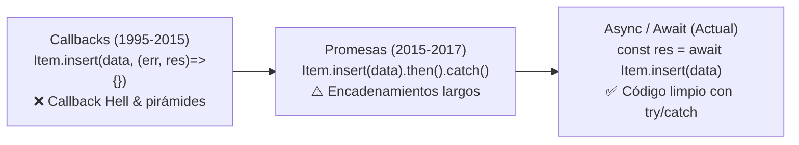
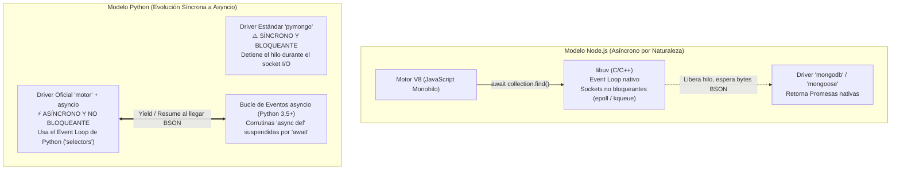
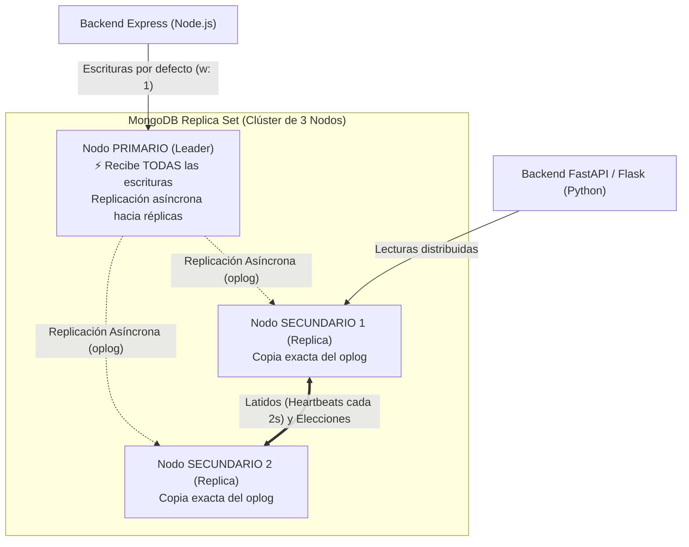
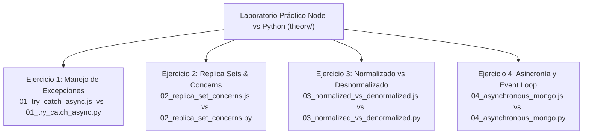

# 🚀 Guía Práctica de Laboratorio: MongoDB con Node.js vs Python (PyMongo)

> **Manual de laboratorio comparativo paso a paso basado en el compendio teórico de MongoDB (`theory/Mongo DB.pdf`).**  
> *Aprende a ejecutar y comparar cada concepto mediante scripts paralelos en JavaScript (`node archivo.js`) y en Python (`python3 archivo.py`).*

---

## 🧭 Tabla de Contenidos

1. [El Manejo de Errores: `try / catch` en JavaScript frente a `try / except / else / finally` en Python](#1-el-manejo-de-errores-try--catch-en-javascript-frente-a-try--except--else--finally-en-python)
2. [La Concurrencia Asíncrona: De Callbacks a `async / await`](#2-la-concurrencia-asíncrona-de-callbacks-a-async--await)
3. [Alta Disponibilidad en MongoDB: Replica Sets y el Teorema CAP](#3-alta-disponibilidad-en-mongodb-replica-sets-y-el-teorema-cap)
4. [Consistencia Eventual Modulable: El Dilema Velocidad vs Consistencia](#4-consistencia-eventual-modulable-el-dilema-velocidad-vs-consistencia)
   - 4.1. `writeConcern` al microscopio (`w: 1` vs `w: "majority"`)
   - 4.2. `readConcern` al microscopio (`"local"` vs `"majority"`)
5. [Modelado de Datos en MongoDB: Normalizado vs Desnormalizado (Slide 63)](#5-modelado-de-datos-en-mongodb-normalizado-vs-desnormalizado-slide-63)
   - 5.1. Consulta Normalizada: Agregación con `$lookup` (Estilo SQL JOIN)
   - 5.2. Consulta Desnormalizada: Proyecciones sobre documentos embebidos
   - 5.3. El Caso To-Do List: Por qué `awcodeAtlas.js` embebe `items: [itemsSchema]`
6. [Laboratorio de Scripts Prácticos: Recorrido y Ejecución](#6-laboratorio-de-scripts-prácticos-recorrido-y-ejecución)

---

## 1. El Manejo de Errores: `try / catch` en JavaScript frente a `try / except / else / finally` en Python

Una de las preguntas más frecuentes al dar el salto de JavaScript a Python es: **¿Cómo se hace un `try / catch` en Python?**

### La Diferencia Fundamental de Sintaxis

* En **JavaScript (Node.js)** usamos la palabra reservada `catch`:
  ```javascript
  try {
    // Código propenso a fallos
    throw new Error("Fallo de conexión");
  } catch (err) {
    // Captura del error
    console.error("Error capturado:", err.message);
  } finally {
    // Se ejecuta SIEMPRE
    console.log("Limpieza completada");
  }
  ```

* En **Python**, la palabra reservada es `except` (¡no existe `catch`!). Además, Python incorpora un bloque adicional muy útil llamado `else`:
  ```python
  try:
      # Código propenso a fallos
      raise ValueError("Fallo de conexión")
  except ValueError as err:
      # Captura de un tipo de error específico
      print(f"Error capturado: {err}")
  except Exception as err:
      # Captura comodín para cualquier otra excepción
      print(f"Error imprevisto: {err}")
  else:
      # ¡EXCLUSIVO DE PYTHON!
      # Se ejecuta SI Y SOLO SI el bloque 'try' terminó con ÉXITO (sin ningún error)
      print("Todo ha salido a la perfección.")
  finally:
      # Se ejecuta SIEMPRE (haya habido error o no)
      print("Limpieza final de sockets y recursos.")
  ```

### Comparativa Visual de Bloques

| Bloque | JavaScript / Node.js | Python | ¿Cuándo se ejecuta? |
| :--- | :--- | :--- | :--- |
| **Intento** | `try { ... }` | `try:` | Siempre al iniciar el flujo. |
| **Captura** | `catch (err) { ... }` | `except Exception as err:` | Si ocurre un fallo en el bloque de intento. |
| **Captura específica** | `if (err instanceof TypeError)` | `except TypeError as err:` | Solo ante ese subtipo de error. |
| **Éxito garantizado** | *(No existe equivalente nativo)* | `else:` | **Únicamente si NO se lanzó ninguna excepción**. |
| **Limpieza final** | `finally { ... }` | `finally:` | **Siempre**, pase lo que pase (haya o no excepción). |

---

## 2. La Concurrencia Asíncrona: De Callbacks a `async / await`

Tal y como señala el PDF de teoría (*Mongo DB.pdf, pág 67*), las librerías modernas de bases de datos han **deprecado los callbacks tradicionales**:



### 2.1. ¿Por qué `await` con `try/catch` o `try/except` revolucionó la programación?

Cuando usábamos callbacks, capturar excepciones requería comprobar `if (err)` en cada nivel de indentación. Con `async / await`:
1. El código se escribe y se lee de forma **secuencial (síncrona a la vista)**, pero se ejecuta de forma **no bloqueante (asíncrona bajo el capó)**.
2. Cada vez que el motor encuentra un `await`, suspende temporalmente esa corrutina y **libera el Event Loop** de Node.js o Python para atender otras conexiones de red o peticiones entrantes.
3. Si la base de datos devuelve un fallo (por ejemplo, timeout de red o duplicado de clave única), la promesa rechazada se transforma automáticamente en una **excepción estándar**, interceptable mediante un `catch` en Node.js o un `except` en Python.

---

### 2.2. Anatomía de la Asincronía: ¿Cómo trata Python las llamadas asíncronas a MongoDB?

Para entender cómo trata Python la asincronía frente a Node.js, debemos examinar qué ocurre bajo el capó en ambos entornos:



#### 1. El pecado original: PyMongo tradicional es bloqueante
En Node.js, **todo** el ecosistema nació asíncrono sobre la librería C/C++ `libuv`.  
En cambio, Python nació como un lenguaje puramente síncrono. Por ello, el driver estándar **`pymongo` es síncrono**: si ejecutas `collection.find_one()`, el hilo del procesador se **congela** esperando que el cable de red devuelva la respuesta de MongoDB Atlas.

#### 2. La solución oficial de MongoDB: El driver `motor`
Para que Python trabaje con MongoDB igual que Node.js (usando `await` sin bloquear el servidor), MongoDB desarrolló **`motor`** (`AsyncIOMotorClient`).
* `motor` envuelve las operaciones de red en el **Event Loop de `asyncio`**.
* Al ejecutar:
  ```python
  documento = await coleccion.find_one({"name": "Comprar pan"})
  ```
  Python **no bloquea el hilo**. Pausa la corrutina actual, registra el descriptor de archivo del socket TCP en el multiplexor del sistema operativo (`kqueue` en macOS o `epoll` en Linux) y cede el control al bucle de eventos para atender peticiones de otros usuarios.
* Cuando el clúster de Atlas envía los bytes BSON por el socket TCP, el sistema operativo despierta al bucle de eventos, y este reanuda la corrutina en el punto exacto donde la dejó.

#### 3. Concurrencia masiva: `Promise.all()` frente a `asyncio.gather()`
Si necesitas consultar 3 colecciones simultáneamente a MongoDB:

* **En JavaScript:**
  ```javascript
  const [usuarios, productos, pedidos] = await Promise.all([
    db.collection("users").find().toArray(),
    db.collection("products").find().toArray(),
    db.collection("orders").find().toArray()
  ]);
  ```
* **En Python:**
  ```python
  usuarios, productos, pedidos = await asyncio.gather(
      db["users"].find().to_list(100),
      db["products"].find().to_list(100),
      db["orders"].find().to_list(100)
  )
  ```
En ambos casos, las tres consultas viajan a MongoDB Atlas **al mismo tiempo**, y la respuesta total tarda el tiempo de la más lenta, no la suma de las tres.

#### 4. ¿Y qué pasa con el famoso GIL (Global Interpreter Lock) de Python?
Un error conceptual habitual es pensar que el GIL impide la concurrencia en Python:
* El GIL solo restringe la ejecución simultánea de código de cálculo puro en CPU sobre múltiples hilos nativos.
* **En operaciones de entrada/salida (I/O) de red contra MongoDB, el GIL no es ningún impedimento**: `asyncio` corre cooperativamente en un solo hilo (exactamente igual que Node.js), permitiendo que un único proceso Python gestione **miles de conexiones concurrentes a MongoDB Atlas** sin sobrecarga de memoria.

Cuando usábamos callbacks, capturar excepciones requería comprobar `if (err)` en cada nivel de indentación. Con `async / await`:
1. El código se escribe y se lee de forma **secuencial (síncrona a la vista)**, pero se ejecuta de forma **no bloqueante (asíncrona bajo el capó)**.
2. Cada vez que el motor encuentra un `await`, suspende temporalmente esa corrutina y **libera el Event Loop** de Node.js o Python para atender otras conexiones de red o peticiones entrantes.
3. Si la base de datos devuelve un fallo (por ejemplo, timeout de red o duplicado de clave única), la promesa rechazada se transforma automáticamente en una **excepción estándar**, interceptable mediante un `catch` en Node.js o un `except` en Python.

---

## 3. Alta Disponibilidad en MongoDB: Replica Sets y el Teorema CAP

En entornos de producción reales (como **MongoDB Atlas**), nunca se ejecuta una única instancia de base de datos aislada (*Standalone*), ya que representaría un punto único de fallo (*Single Point of Failure*).

En su lugar, MongoDB se organiza en un **Replica Set** (*Mongo DB.pdf, págs 12-13*):



### Mecanismos Clave del Replica Set:
1. **Un solo Primario:** Todas las escrituras (`insert`, `update`, `delete`) viajan obligatoriamente al nodo Primario.
2. **Replicación Asíncrona vía `oplog`:** El primario registra cada mutación en un log especial (`local.oplog.rs`) y los secundarios replican esos cambios de forma continua.
3. **Elección Automática por Quórum:** Los nodos se envían señales de latido (*heartbeats*) cada 2 segundos. Si el nodo primario cae o su servidor se desconecta, los nodos secundarios celebran una votación democrática instantánea (usando el algoritmo de consenso Raft) y eligen a un nuevo Primario en menos de 3 a 5 segundos.

---

## 4. Consistencia Eventual Modulable: El Dilema Velocidad vs Consistencia

Dado que la replicación entre el primario y los secundarios es **asíncrona**, existe un intervalo de milisegundos en el que un secundario todavía no ha terminado de copiar los datos nuevos escritos en el primario.  

Esto significa que, según el **Teorema CAP**, MongoDB opera por defecto como un sistema **AP** (Alta Disponibilidad y Tolerancia a Particiones), proporcionando **Consistencia Eventual** (*Eventual Consistency*).

> [!IMPORTANT]
> **Lo verdaderamente extraordinario de MongoDB:**  
> La consistencia no es fija: **es completamente modulable por el desarrollador** mediante dos directivas:
> - **`writeConcern`** (para calibrar la seguridad al escribir).
> - **`readConcern`** (para calibrar la frescura al leer).

```
   ⚡ MÁXIMA VELOCIDAD / DISPONIBILIDAD               🛡️ MÁXIMA CONSISTENCIA / INTEGRIDAD
   (w: 1, readConcern: 'local')                       (w: 'majority', readConcern: 'majority')
◄─────────────────────────────────────────────────────────────────────────────────────────────►
   • Latencia ultra-baja (1-2 ms)                      • Mayor latencia de red (10-40 ms)
   • Riesgo de leer datos antiguos (stale)            • Cero inconsistencias ni 'dirty reads'
   • Posible pérdida en failover (rollback)           • Confirmado por quórum en disco físico
```

---

### 4.1. `writeConcern` al microscopio

Indica a cuántos miembros del Replica Set debe llegar la escritura antes de que MongoDB devuelva una respuesta exitosa a nuestra aplicación Node.js o Python:

| Nivel de Write Concern | Funcionamiento | Velocidad | Seguridad ante caídas |
| :--- | :--- | :---: | :---: |
| **`w: 0`** (No reconocido) | "Dispara y olvida". El cliente envía los datos y continúa sin esperar confirmación. | 🚀 Máxima | ❌ Nula (si la red falla, los datos se pierden en silencio). |
| **`w: 1`** (Por defecto tradicional) | El cliente espera a que el **nodo Primario** guarde el dato en su memoria. | ⚡ Muy Alta | ⚠️ Media (si el Primario sufre un corte eléctrico antes de replicar a los secundarios, los datos se perderán). |
| **`w: "majority"`** (Estándar de seguridad) | Espera a que la **mayoría estricta de nodos** (ej. 2 de 3) hayan recibido y reconocido la escritura. | ⏱️ Equilibrada | 🛡️ **Total**. Aunque el Primario se incendie, los datos ya residen en la réplica que será votada como nuevo líder. |
| **`j: true`** (Journaling) | Espera además a que la transacción se escriba en el archivo de diario físico de disco duro. | 🐢 Más lenta | 💾 Inmune a cortes bruscos de energía. |

---

### 4.2. `readConcern` al microscopio

Indica el nivel de garantía y aislamiento exigido al recuperar datos de una consulta:

| Nivel de Read Concern | Comportamiento | Casos de uso |
| :--- | :--- | :--- |
| **`"local"`** (Por defecto) | Retorna los datos más recientes del nodo consultado. No comprueba si han sido confirmados por la mayoría del clúster. | Feed de noticias, contadores de visitas, logs analíticos. |
| **`"available"`** | Diseñado para máxima disponibilidad en clústeres particionados. Es el más rápido, pero puede leer datos huérfanos. | Aplicaciones donde la velocidad prima sobre la exactitud inmediata. |
| **`"majority"`** | Devuelve únicamente documentos que han sido reconocidos por la mayoría de nodos. **Garantiza que la lectura nunca sufrirá un rollback**. | Carritos de la compra, transferencias, control de inventario. |
| **`"linearizable"`** | Espera a que el nodo primario se comunique con el quórum en tiempo real para garantizar que sigue siendo el líder legítimo antes de responder. | Operaciones financieras críticas con cero margen de tolerancia. |

---

## 5. Modelado de Datos en MongoDB: Normalizado vs Desnormalizado (Slide 63)

En la diapositiva **"Query in normalized and denormalized case"** (*Mongo DB.pdf, pág 63*), se expone el dilema clásico del modelador de bases de datos NoSQL:

---

### 5.1. Consulta Normalizada (Uso de `$lookup` / Agregaciones)
Las entidades se separan en colecciones distintas vinculadas por IDs (como tablas relacionales):

```javascript
// Colección 'authors': { _id: ObjectId("auth1"), name: "Alice" }
// Colección 'posts':   { _id: ObjectId("post1"), title: "Post 1", author_id: ObjectId("auth1") }

// Consulta en Node.js o PyMongo:
db.posts.aggregate([
  {
    $lookup: {
      from: "authors",
      localField: "author_id",
      foreignField: "_id",
      as: "author_details"
    }
  },
  {
    $project: {
      title: 1,
      author_name: "$author_details.name"
    }
  }
]);
```
* **Ventaja:** Evita redundancia. Si Alice actualiza su nombre, solo se modifica un documento en `authors`.
* **Desventaja:** Mayor coste de CPU y memoria. MongoDB debe realizar una unión ($O(N)$) en memoria en cada consulta.

---

### 5.2. Consulta Desnormalizada / Embebida
La entidad autora se incrusta directamente en el propio documento del artículo:

```javascript
// Colección 'posts':
// { _id: ObjectId("post1"), title: "Post 1", author: { name: "Alice", email: "alice@email.com" } }

// Consulta instantánea:
db.posts.find({}, { title: 1, "author.name": 1 });
```
* **Ventaja:** **Velocidad pura ($O(1)$)**. No hay uniones, tablas cruzadas ni latencia añadida. Un solo paquete BSON viaja por la red.
* **Desventaja:** Redundancia. Si Alice cambia de nombre, el servidor debe actualizar todos los posts donde aparezca.

---

### 5.3. El Caso To-Do List: ¿Por qué `awcodeAtlas.js` embebe `items: [itemsSchema]`?
Tal como expone la diapositiva 69 (*"example composition where I used embedded for simplicity"*):

```javascript
const itemsSchema = {
   name: String
};

const listSchema = {
   name: String,
   items: [itemsSchema] // Array de subdocumentos embebidos
};
```

1. **Relación de Composición Estricta:** Una tarea de "Comprar pan" no tiene identidad ni valor sin la lista a la que pertenece.
2. **Cero JOINs en la interfaz:** Al renderizar la página `/:customListName`, un único `List.findOne({ name: customListName })` devuelve el título y todos sus ítems en un abrir y cerrar de ojos.
3. **Borrado Natural:** Si borras la lista, desaparecen sus tareas de forma automática sin riesgo de dejar registros huérfanos.

---

## 6. Laboratorio de Scripts Prácticos: Recorrido y Ejecución

En la carpeta [`materiales_didacticos/mongo/theory/`](./) tienes disponibles los 4 pares de scripts paralelos listos para ejecutar tanto en Node.js como en Python:



---

### 💻 Ejercicio 1: Comparativa de Control de Errores con `await`

* **Versión JavaScript:**
  ```bash
  node materiales_didacticos/mongo/theory/01_try_catch_async.js
  ```
  *Demuestra el uso de `try { ... } catch (err) { ... } finally { ... }` envolviendo llamadas `await client.connect()`.*

* **Versión Python:**
  ```bash
  python3 materiales_didacticos/mongo/theory/01_try_catch_async.py
  ```
  *Demuestra la sintaxis `try: ... except Exception as err: ... else: ... finally:` y corrutinas con `asyncio`.*

---

### 🌐 Ejercicio 2: Ajuste de `writeConcern` y `readConcern` en Replica Sets

* **Versión JavaScript:**
  ```bash
  node materiales_didacticos/mongo/theory/02_replica_set_concerns.js
  ```
  *Configura un cliente rápido (`w: 1`, `readConcern: 'local'`) frente a un cliente seguro (`w: 'majority'`, `j: true`, `readConcern: 'majority'`).*

* **Versión Python:**
  ```bash
  python3 materiales_didacticos/mongo/theory/02_replica_set_concerns.py
  ```
  *Aplica los objetos `WriteConcern` y `ReadConcern` nativos de PyMongo a nivel de colección para transacciones bancarias seguras.*

---

### 📑 Ejercicio 3: Query en Caso Normalizado vs Desnormalizado (Slide 63)

* **Versión JavaScript:**
  ```bash
  node materiales_didacticos/mongo/theory/03_normalized_vs_denormalized.js
  ```
  *Ejecuta la comparativa entre la agregación `$lookup` frente a la proyección directa sobre documentos y la estructura To-Do List.*

* **Versión Python:**
  ```bash
  python3 materiales_didacticos/mongo/theory/03_normalized_vs_denormalized.py
  ```
  *Genera las estructuras JSON equivalentes y demuestra la sintaxis de pipelines de agregación en PyMongo.*

---

### ⚡ Ejercicio 4: Anatomía de la Asincronía y Concurrencia (Promise.all vs asyncio.gather)

* **Versión JavaScript:**
  ```bash
  node materiales_didacticos/mongo/theory/04_asynchronous_mongo.js
  ```
  *Demuestra cómo libuv gestiona sockets no bloqueantes y lanza múltiples consultas paralelas con `Promise.all()`.*

* **Versión Python:**
  ```bash
  python3 materiales_didacticos/mongo/theory/04_asynchronous_mongo.py
  ```
  *Demuestra el bucle de eventos de Python con corrutinas concurrentes usando `asyncio.gather()` y el patrón de conexión con `motor`.*

---

## 🎯 Resumen para el Alumno

1. **En Python no hay `catch`, hay `except`**, y el bloque `else` complementario solo corre si no hubo fallos.
2. **`await` libera el hilo principal** tanto en Node.js como en Python (`asyncio`), permitiendo concurrencia masiva sin necesidad de crear hilos pesados del sistema operativo.
3. **El Replica Set garantiza la supervivencia** de tu clúster MongoDB con 1 líder y réplicas con votación automática.
4. **La Consistencia Eventual se modula con precisión**: puedes elegir rapidez máxima (`w: 1`, `local`) o blindaje absoluto (`w: 'majority'`, `majority`).
5. **Embeber es la regla de oro de MongoDB**: si los datos se leen juntos, guárdalos juntos. Deja las referencias y el `$lookup` para cuando la duplicación sea inasumible.

